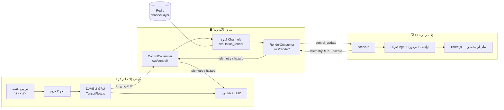

# معماری SelfDriveSim

این سند معماری کامل سیستم حلقه‌بسته را توضیح می‌دهد: لایه‌ها، جریان داده روی WebSocket و
چرخه حیات یک فریم از لحظه ثبت دوربین گوشی تا حرکت خودرو روی مانیتور.

## نمای کلی

جریان در یک جمله: تصویر هرگز از گوشی خارج نمی‌شود؛ فقط **چهار عدد** از `/ws/control/`
می‌آید، سرور آن را اعتبارسنجی و از طریق Redis به `/ws/render/` می‌رساند، صحنه آن را به
حرکت تبدیل می‌کند و سرعت/هشدارها مسیر معکوس را برمی‌گردند.

## لایه‌ها

### لایه موبایل (ادراک و استنتاج)

| جزء | فایل | نقش |
|---|---|---|
| دوربین | `getUserMedia` با ترجیح `facingMode: environment` | ویدیوی زنده مانیتور |
| نمونه‌بردار | `<canvas>` مخفی ۱۶۰×۱۲۰ در `inference.js` | کوچک‌سازی هر فریم به ورودی مدل (raw 0..255) |
| استنتاج | `inference.js` + `reset-after-gru.js` + `tf.min.js` (vendor) | GRU سفارشی با `reset_after=True` که tfjs ندارد؛ حلقه ۵۰ms |
| داشبورد | `dashboard.html` + CSS | فرمان، پدال‌ها، غربیلک، راهنماها، سرعت، بنر هشدار |

- مدل قبل از دوربین بارگذاری می‌شود (`data-model-url`)؛ در خطا به Mock فاز ۳ برمی‌گردد.
- فریم‌ها فقط در `ArrayBuffer` گوشی می‌مانند؛ خروجی شبکه clamp و در یک فریم JSON ارسال می‌شود.
- صفحه مخفی/قطع شبکه/خطای دوربین ⇒ توقف استنتاج؛ شروع مجدد هرگز خودکار نیست.

### لایه شبکه (رله)

| جزء | فایل | نقش |
|---|---|---|
| ASGI | `selfdriving_sim/asgi.py` + Daphne | HTTP + WebSocket در یک پورت |
| کانسیومرها | `simulation/consumers.py` | `ControlConsumer` (گوشی) و `RenderConsumer` (صحنه) |
| گروه | `simulation_render` | fan-out بین همه اعضا؛ چند Daphne با یک Redis کار می‌کنند |
| لایه کانال | `settings.py` → `channels_redis` | transport پیام گروه |

اعتبارسنجی سرور (قبل از broadcast): `sanitize_command` بازه‌ها را clip می‌کند،
`turn_signal` به کلاس ۰/۱/۲ گرد می‌شود، فریم خراب ⇒ `{"type":"error", ...}` فقط به فرستنده
و اتصال باز می‌ماند. `sanitize_telemetry` و `sanitize_hazard` همین کار را برای مسیر معکوس
می‌کنند و فقط انواع مجاز را relay می‌کنند.

### لایه PC (رندر و فیزیک)

| جزء | فایل | نقش |
|---|---|---|
| صحنه | `simulation/static/simulation/js/scene.js` | ساخت دنیا، فیزیک ego، ترافیک، برخورد، HUD، چشمک‌زن |
| رندرر | Three.js r160 (vendor) | نمای اول‌شخص روی سپر جلو، سایه، مه |
| کلاینت WS | همان `scene.js` | اتصال به `/ws/render/`، backoff نمایی ۱۰ تلاشی |
| ورودی دستی | کیبورد ↑↓←→ / WASD | وقتی بیش از ۰.۵ ثانیه فرمان تازه نرسد، کیبورد می‌راند |

نکته مهم قرارداد جهت: جلو = `−z` و `STEERING_SIGN = 1` تا فرمان مثبت DAVE-2 = پیچ به
**راستِ تصویر** باشد (توضیح کامل در `docs/phase-5-closed-loop.md`).

## جریان داده روی WebSocket

| نوع پیام | مسیر | تواتر | ساختار | اعتبارسنجی |
|---|---|---|---|---|
| فرمان رانندگی | گوشی → `/ws/control/` → گروه → `/ws/render/` → صحنه | ~۲۰Hz | `{"steering":…, "throttle":…, "brake":…, "turn_signal":…}` | clip به بازه‌های پروتکل |
| تلومتری | صحنه → `/ws/render/` → گروه → گوشی | ۴Hz | `{"type":"telemetry","speed_kmh":…}` | clip به ۰..۴۰۰ |
| هشدار | صحنه → `/ws/render/` → گروه → گوشی | رویدادی | `{"type":"hazard","hazard":"collision"\|"wall"}` | فقط انواع مجاز |
| خطا | سرور → فرستنده همان سوکت | رویدادی | `{"type":"error","message":"…"}` | — |

هر دو endpoint عضو گروه `simulation_render` هستند؛ echo هر پیام نزد فرستنده‌اش drop
می‌شود تا حلقه‌ای محلی شکل نگیرد.

## چرخه حیات یک فریم

از دوربین گوشی تا حرکت خودرو، برای یک تیک حلقه ۵۰ms گوشی:

1. **ثبت (۰–۵ms):** `drawImage` ویدیو را به canvas مخفی ۱۶۰×۱۲۰ می‌کشد؛ پیکسل‌ها همان‌جا می‌مانند.
2. **پنجره‌بندی:** فریم به بافر اضافه می‌شود؛ مدل همیشه روی **۳ فریم جدید** کار می‌کند (پنجره ≈ ۱۵۰ms گذشته).
3. **استنتاج (~۱۰–۳۰ms روی میان‌رده مدرن):** TimeDistributed-CNN → GRU(128) → چهار head.
4. **کلمپ و ارسال (<۱ms):** `toCommand` بازه‌ها را تضمین می‌کند؛ یک فریم JSON به `/ws/control/` می‌رود.
5. **رله سرور (<۱–۳ms روی LAN):** sanitize → `group_send` → Redis → `RenderConsumer` → صفحه.
6. **فیزیک صحنه (در فریم بعدی rAF):** `applyControls` فرمان را ذخیره می‌کند؛ سپس با
   `dt = min(clock.getDelta(), 0.1)`: سرعت → heading → موقعیت → دیوار → مش.
7. **برخورد و HUD:** Box3 با هر ترافیک فعال؛ رویداد ⇒ فلاش + hazard؛ HUD ۴Hz به‌روز می‌شود.
8. **رندر:** دوربین روی سپر جلو، ۳۰ واحد جلوتر را نگاه می‌کند؛ صحنه بی‌پایان با snap دورهٔ خط‌چین.
9. **بازخورد:** هر ۰.۲۵ ثانیه تلومتری سرعت به گوشی می‌رود و عدد سرعت داشبورد به‌روز می‌شود؛
   گوشی این سرعت را در کنار فرمان نمایش می‌دهد (و در آینده می‌تواند در تصمَد مدل لحاظ شود).

زنجیره کامل (دوربین تا پیکسل) روی LAN معمولاً **۶۰–۱۲۰ms** و روی ngrok **۱۰۰–۲۵۰ms** است؛
تجزیه و کاهش آن در `docs/troubleshooting.md` آمده است.

## قرارداد پایداری

- فرمان کهنه (بیش از `COMMAND_FRESH_S = 0.5s`) نادیده گرفته می‌شود ⇒ قطعی شبکه خودرو را
  نمی‌ایستاند، کیبورد برمی‌گردد.
- قطع `/ws/render/` ⇒ backoff نمایی ۰.۵s تا سقف ۱۵s و حداکثر ۱۰ تلاش، سپس وضعیت قرمز در HUD.
- شروع/توقف استنتاج فقط با دکمه‌های صریح داشبورد؛ توقف یک فرمان «ترمز کامل» best-effort
  می‌فرستد و تضمین ایمنی نیست.
