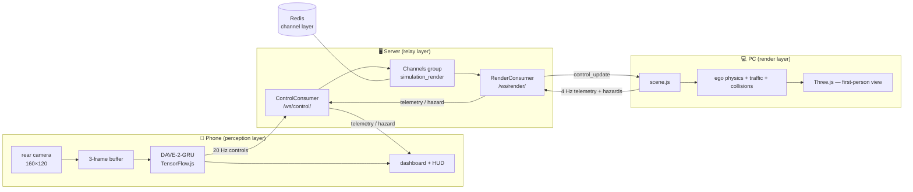

# SelfDriveSim guide — version 1.0

## Contents

| Section | Topic |
|---|---|
| [1](#1-introduction) | Introduction |
| [2](#2-requirements) | Requirements |
| [3](#3-setup-and-running) | Setup and running |
| [4](#4-connecting-the-phone-with-the-chrome-flag) | Connecting the phone (Chrome flag) |
| [5](#5-architecture-and-the-websocket-protocol) | Architecture and the WebSocket protocol |
| [6](#6-scene-physics-and-hud) | Scene physics and HUD |
| [7](#7-the-dave-2-gru-model-and-the-conversion-pipeline) | The DAVE-2-GRU model and the conversion pipeline |
| [8](#8-troubleshooting) | Troubleshooting |
| [9](#9-tests) | Tests |
| [10](#10-results-and-limitations) | Results and limitations |

## 1. Introduction

A closed-loop, end-to-end self-driving simulator that runs entirely on hardware you already
own: a PC, a phone, and a Wi-Fi network.

A Three.js scene on the PC renders a first-person three-lane road with random oncoming
traffic, full screen. A phone mounted on a stand in front of the monitor watches that screen
through its rear camera. In the phone's browser — no app install, no server-side GPU — a
DAVE-2-GRU convolutional-recurrent network runs on TensorFlow.js, analyses the last three
camera frames and produces four driving commands: `steering` (−1…1), `throttle` (0…1),
`brake` (0…1) and `turn_signal` (0 off / 1 left / 2 right). The commands travel over a
WebSocket through Django Channels, and the car in the scene applies them with a simple
kinematic model: it accelerates, brakes, coasts, steers, blinks its turn signals three times
a second, grinds against an invisible road wall and crashes into traffic. Speed telemetry and
collision/wall hazards flow back to the phone, closing the loop.

No camera frame ever leaves the phone; only the four control numbers travel over the local
network.

```
 ┌───────────────────────── PC ─────────────────────────┐      ┌────────────────── Phone ──────────────────┐
 │                                                      │      │                                           │
 │  Three.js first-person scene  ←── control_update ──┐ │      │  rear camera (160×120 frames)             │
 │   • ego physics (speed/heading)                   │ │      │        ↓ 3-frame window                   │
 │   • traffic, collisions, walls                    │ │      │  DAVE-2-GRU in TensorFlow.js (browser)    │
 │   • HUD: speed, heading, signals, counters        │ │      │        ↓ 20 Hz                            │
 │        ↓ telemetry 4 Hz, hazards                  │ │      │  steering · throttle · brake · turn_signal│
 └──────────────┬────────────────────────────────────┼─┘      └───────────────┬───────────────────────────┘
                │              ┌─────────────────────┘                        │ control frames
                │              │ /ws/render/                                  │ /ws/control/
                └──────────────┤ Django Channels + Daphne (ASGI) ←────────────┘
                               │   validation · clipping · group fan-out
                               └───────────────┬─────────────────────────────
                                               │
                                        [( Redis channel layer )]
```

## 2. Requirements

- **Python 3.11** — the tested version. Ubuntu 22.04 ships 3.10 and Ubuntu 24.04 ships 3.12;
  for 3.11 use the deadsnakes PPA:
  `sudo add-apt-repository ppa:deadsnakes/ppa && sudo apt install python3.11 python3.11-venv`.
- **Redis 6+** — the Channels layer that fans frames out between the WebSocket consumers.
- **A modern browser** — Chrome/Edge (PC and phone), Firefox, Safari 16+.
- **Node.js 20+** *(optional)* — only for the frontend test suite and rebuilding the Tailwind
  stylesheet.
- **For the model pipeline only:** Linux/macOS (TensorFlow has no Windows wheels; use WSL2 on
  Windows).

## 3. Setup and running

All commands run from `selfdriving_sim/`.

### 3.1 Redis

```bash
sudo apt update
sudo apt install -y redis-server
sudo systemctl enable --now redis-server
redis-cli ping   # PONG
```

### 3.2 Virtual environment and dependencies

```bash
python3.11 -m venv .venv
source .venv/bin/activate          # Windows: .venv\Scripts\activate
pip install --upgrade pip
pip install -r requirements.txt
python manage.py migrate
```

The TensorFlow packages in `requirements.txt` install on Linux and macOS only; Windows users
should run the whole ML toolchain inside WSL2. The server and the web test suite need no
TensorFlow.

### 3.3 Local configuration (optional)

A `.env` file in this directory overrides the defaults. Real environment variables take
precedence over the file.

| Variable | Default | Purpose |
|---|---|---|
| `DJANGO_SECRET_KEY` | development placeholder | Django secret key; set a real value outside development. |
| `REDIS_HOST` | `127.0.0.1` | Redis host for the channel layer. |
| `REDIS_PORT` | `6379` | Redis port for the channel layer. |
| `DJANGO_CSRF_TRUSTED_ORIGINS` | empty | Extra origins, comma-separated, allowed to send unsafe requests. |
| `SIMULATION_CONTROL_LOG_LEVEL` | `INFO` | Console logging for validated controls; `WARNING` silences the 20 Hz stream. |
| `DJANGO_ALLOW_IFRAME_PREVIEW` | unset | Set to `1` only for an embedded development preview; disables X-Frame-Options while `DEBUG` is true. |

### 3.4 Running the server

The easiest path is the launcher: it checks Redis, applies migrations, collects static files
and prints the URLs for the PC and the phone (including the detected LAN address):

```bash
./scripts/run.sh      # Linux/macOS
scripts\run.bat       # Windows
```

Manual equivalent:

```bash
python manage.py runserver 0.0.0.0:8000
```

`runserver` wraps the application in `ASGIStaticFilesHandler` and serves HTTP, WebSocket and
the static files together. Standalone Daphne (`daphne -b 0.0.0.0 -p 8000
selfdriving_sim.asgi:application`) does **not** serve the static files; in that case run
`python manage.py collectstatic` and serve `staticfiles/` next to Daphne with a web server.

| Path | Description |
|---|---|
| `GET /` | The Three.js scene (on the PC, fullscreen with F11). |
| `GET /dashboard/` | The RTL mobile dashboard, which runs the model in the browser. |
| `GET /health/` | `{"status": "ok", "version": "1.0.0"}`. |
| `/admin/` | Django admin site. |
| `/ws/control/` | WebSocket endpoint for the phone. |
| `/ws/render/` | WebSocket endpoint for the Three.js page. |

### 3.5 Repository layout

```
SelfDriveSim/
├── README.md                    short introduction and quick start
└── selfdriving_sim/
    ├── manage.py
    ├── requirements.txt
    ├── package.json             CSS build and frontend test commands
    ├── pytest.ini, playwright.config.js, conftest.py
    ├── scripts/                 run.sh / run.bat
    ├── selfdriving_sim/         settings, ASGI/WSGI entry points, root URLs
    ├── simulation/              the scene app: page, consumers, scene.js, tests
    ├── client/                  the phone app: dashboard, camera + inference.js,
    │                            converted DAVE-2-GRU model, vendored TF.js, tests
    ├── models/                  checkpoint download → extension → TF.js conversion
    └── docs/
        ├── guide.fa.md          Persian guide
        └── guide.en.md          this document
```

## 4. Connecting the phone with the Chrome flag

Browsers only grant camera access in a **secure context**: `https://` or `http://localhost`.
`http://<other-ip>:8000` on the phone does not give camera access by default. The official
route of this project is the Chrome flag: no internet tunnel, no third-party service, and
camera frames plus commands stay entirely on the local network.

### 4.1 Step by step

1. **Both devices on the same Wi-Fi.** Find the PC's local IP address:
   - Linux/macOS: `hostname -I` (the first address that is not `127.0.0.1`)
   - Windows: `ipconfig` (the `IPv4 Address` of the Wi-Fi adapter)

   Example: `192.168.1.42`. Make sure the phone and the PC are on the same network and that
   "AP isolation" is off.

2. **Start the server on every interface** (with `runserver`, which serves the static files):

   ```bash
   python manage.py runserver 0.0.0.0:8000
   ```

3. **Enable the flag in Chrome on the phone.** Open in the phone's address bar:

   ```
   chrome://flags/#unsafely-treat-insecure-origin-as-secure
   ```

   - Set it to **Enabled**.
   - In the text box, type **exactly** your own origin:
     `http://192.168.1.42:8000` (with the port, without `/dashboard/`, without a trailing
     slash).
   - Press **Relaunch** so Chrome restarts. (If there is no button, fully close Chrome and
     open it again.)

4. **Open the dashboard.** In Chrome on the phone:

   ```
   http://192.168.1.42:8000/dashboard/
   ```

   Tap **Allow** for the camera, place the phone on a stand facing the monitor, then press
   **شروع خودران** (start self-driving). The connection indicator must turn green and the
   send rate should approach 20 FPS. Keep `/` fullscreen (F11) on the PC.

5. **Troubleshooting this route**
   - Chrome resets its flag list after major updates. If «اتصال امن لازم است» (secure
     connection required) comes back, repeat step 3.
   - **AP isolation** is common on guest routers: the phone cannot see the PC. Alternatives:
     the main network without isolation, or the **phone's own hotspot** with the PC joined to
     it (then read the new IP with `hostname -I`/`ipconfig` and update the flag for that
     address).
   - **Windows firewall** for port 8000: the first Python run asks for network access; if it
     was denied, add an inbound rule for TCP 8000 in Windows Defender Firewall.
   - **iOS does not have this flag.** Safari on iPhone cannot mark an insecure origin as
     secure; use the appendix below for iOS.
   - If the flag seems to do nothing, check the order: Enabled → address in the box →
     Relaunch → then open the dashboard. A tab opened before the relaunch does not see the
     flag.

6. **Appendix — the permanent route (and iOS):** a local reverse proxy with an internal
   certificate, without any external service. With [Caddy](https://caddyserver.com/), a
   `Caddyfile`:

   ```caddyfile
   https://192.168.1.42 {
       tls internal
       reverse_proxy 127.0.0.1:8000
   }
   ```

   Run `caddy run`, install the root certificate (`root.crt` from Caddy's data folder) on the
   phone and trust it in the device settings, then open
   `https://192.168.1.42/dashboard/`. This creates a real secure origin, works on iOS too,
   and switches the WebSocket to `wss://` automatically.

### 4.2 Dashboard behaviour

The dashboard prefers the rear camera (`facingMode: { ideal: "environment" }`, desired width
1280) and carries a hidden 160×120 `canvas` (the model's own input size), a steering wheel,
turn arrows, throttle/brake indicators and start/stop buttons. After camera permission
succeeds it opens `/ws/control/` (`wss:` on an HTTPS page, `ws:` on HTTP). The socket URL is
built from `location.host`; the code holds no `localhost` or fixed IP. Nothing is sent until
**شروع خودران** is pressed.

- The 50 ms loop runs the model on the three newest frames and sends only the four control
  numbers; images stay on the phone.
- The model loads before the camera (`data-model-url`) and shows `MODEL LOADING` while it
  does; if loading fails the dashboard falls back to the Mock (indicator `MOCK MODE`). Mock
  commands are sinusoidal and repeatable — they are for exercising the scene, not for
  driving.
- FPS measures successful browser sends, not camera frames and not delivery
  acknowledgements. The displayed speed is the scene car's km/h, forwarded from
  `/ws/render/`; it stays «—» until the simulator page is connected.
- Inbound telemetry updates the speed readout; inbound hazard frames raise a red four-second
  banner («برخورد با دیوار — مسیر را عوض کن»). `parseHazard` accepts only `collision` and
  `wall`.
- A camera failure, a frame-capture error, a server error reply, a dropped connection or more
  than 1024 buffered bytes (`bufferedAmount`) stops the send loop.
- Socket reconnection backs off 0.5, 1, 2, 4, 8, then up to 15 seconds; each handshake is
  closed after 10 unanswered seconds and after 10 attempts the **اتصال مجدد** (reconnect)
  button appears. A recovered connection **never** restarts sending by itself.
- On a hidden page or `pagehide`, the loop and timers are cleared, the socket closed and every
  camera track released. All assets (CSS, Vazirmatn font, TF.js, the model) are local; the
  page makes no external network request.

**Safety limitation:** stopping is a best-effort request with no acknowledgement; if the link
is down it is not guaranteed to arrive. This is a simulator, not a real vehicle controller.

### 4.3 Server log

Every validated command logs one line:

```text
INFO simulation.consumers: Control /ws/control/ steering=0.250 throttle=0.600 brake=0.000 turn_signal=1
```

Only the four validated, clipped numbers are logged; no images or extra payloads. To silence
the 20 Hz stream:

```bash
SIMULATION_CONTROL_LOG_LEVEL=WARNING python manage.py runserver 0.0.0.0:8000
```

### 4.4 Building the local CSS

The compiled stylesheet is committed, so running the server needs no Node. To change the
look:

```bash
npm ci
npm run build:css
npm run watch:css        # optional, in a separate terminal
```

Edit `client/styles/dashboard.css`, not the served
`client/static/client/css/dashboard.css`; rebuild after changing template or JavaScript class
names and commit the output. Font provenance and the OFL license are in
`client/static/client/fonts/`.

## 5. Architecture and the WebSocket protocol



### 5.1 Layers

| Layer | Component | File | Role |
|---|---|---|---|
| Phone | camera | `getUserMedia` with an `environment` preference | live view of the monitor |
| Phone | sampler | hidden 160×120 `canvas` in `inference.js` | resize each frame to the model input (raw 0..255) |
| Phone | inference | `inference.js` + `reset-after-gru.js` + `tf.min.js` | custom `reset_after=True` GRU that tfjs lacks; 50 ms loop |
| Server | ASGI | `selfdriving_sim/asgi.py` + Daphne | HTTP and WebSocket on one port |
| Server | consumers | `simulation/consumers.py` | `ControlConsumer` (phone) and `RenderConsumer` (scene) |
| Server | group | `simulation_render` | fan-out to all members; several processes share one Redis |
| PC | scene | `simulation/static/simulation/js/scene.js` | world, ego physics, traffic, collisions, HUD, blinker |
| PC | renderer | Three.js r160 (vendored) | first-person view from the front bumper, shadows, fog |
| PC | manual input | arrow keys / WASD | drives when no fresh phone command arrives for 0.5 s |

### 5.2 Messages

Both endpoints join the `simulation_render` group (a sender's own echo is dropped so no local
loop forms).

| Message | Path | Rate | Shape | Validation |
|---|---|---|---|---|
| driving command | phone → `/ws/control/` → group → `/ws/render/` → scene | ~20 Hz | `{"steering":…, "throttle":…, "brake":…, "turn_signal":…}` | clipped to the protocol ranges |
| telemetry | scene → `/ws/render/` → group → phone | 4 Hz | `{"type":"telemetry","speed_kmh":…}` | clipped to 0..400 |
| hazard | scene → `/ws/render/` → group → phone | event | `{"type":"hazard","hazard":"collision"\|"wall"}` | known kinds only |
| error | server → the sending socket | event | `{"type":"error","message":"…"}` | — |

Control ranges: `steering` in −1..1, `throttle` and `brake` in 0..1, `turn_signal` 0/1/2
(clipped and rounded to an integer). Malformed JSON, missing fields and non-numeric values
are refused, the error goes only to the sender, and the connection stays open.
`sanitize_telemetry` and `sanitize_hazard` do the same for the return path.

The control frame as the PC page receives it:

```json
{"type": "control_update", "steering": 0.25, "throttle": 0.6, "brake": 0.0, "turn_signal": 1}
```

The scene ignores frames whose `type` is not `control_update` and drops a `control_update`
whose fields are not numbers.

### 5.3 Life of a frame

For one tick of the phone's 50 ms loop:

1. **Capture (0–5 ms):** `drawImage` copies the video into the hidden 160×120 canvas; the
   pixels stay there.
2. **Windowing:** the frame joins the buffer; the model always consumes the **3 newest
   frames** (a window of about 150 ms).
3. **Inference (~10–30 ms on modern mid-range hardware):** TimeDistributed CNN → GRU(128) →
   four heads.
4. **Clamp and send (<1 ms):** `toCommand` guarantees the ranges; one JSON frame goes to
   `/ws/control/`.
5. **Server relay (<1–3 ms on a LAN):** sanitize → `group_send` → Redis → `RenderConsumer` →
   the page.
6. **Scene physics (next `requestAnimationFrame`):** `applyControls` stores the command, then
   with `dt = min(clock.getDelta(), 0.1)`: speed → heading → position → wall → mesh.
7. **Collisions and HUD:** `Box3` against every active traffic car; an event raises a flash
   and a hazard; the HUD updates at 4 Hz.
8. **Render:** the camera sits on the front bumper and looks 30 units ahead; the endless road
   snaps forward in whole dash periods.
9. **Feedback:** every 0.25 s a speed telemetry frame returns to the phone.

The full chain (camera to pixel) is usually **60–120 ms** on a LAN; the breakdown and how to
cut it is in [Troubleshooting](#8-troubleshooting).

### 5.4 Resilience contract

- A stale command (`COMMAND_FRESH_S = 0.5 s`) is ignored, so a network drop does not stop the
  car — the keyboard takes over.
- A dropped `/ws/render/` reconnects with exponential backoff from 0.5 s up to 15 s, at most
  10 attempts, then the HUD stays red until the page is reloaded.
- Inference starts and stops only through the explicit dashboard buttons; stopping sends one
  best-effort full-brake command and is not a safety guarantee.

## 6. Scene physics and HUD

### 6.1 The car

The car owns `{x, z, speed, heading}` in world space and drives towards `−z`. Per frame with
`dt = min(clock.getDelta(), 0.1)`:

| Step | Rule |
|---|---|
| Longitudinal | `brake > 0.1` ⇒ `speed -= 20·brake·dt`; else `throttle > 0.1` ⇒ `speed += 8·throttle·dt`; else constant `2 m/s²` friction. Clipped to `0…20 m/s`. |
| Heading | only above `0.5 m/s`: `heading += steering · 1.5 · min(1, speed/5) · dt` |
| Position | `x += sin(heading)·speed·dt`, `z -= cos(heading)·speed·dt` |
| Wall | `\|x\| ≤ 9` is clamped; grinding scrubs 15 m/s² off the speed and raises a `wall` event |
| Collision | `Box3` overlap with traffic ⇒ red flash, full stop, counter, ~1 s freeze, then a reset to the centre lane with 2 s immunity |
| Turn signal | `blinkerPhase += dt·3`, toggled on `floor(phase) % 2` — three state changes per second |

`STEERING_SIGN = 1` maps the model's positive steering onto a turn to the **right of the
image**. Forward is `−z` so that the right of the image is world `+x`; with that convention a
positive DAVE-2 steering follows the road curvature. If a real-phone test shows the opposite,
flip that single constant in `scene.js` to `-1`.

### 6.2 The world

- A straight, **endless** three-lane road, 20 units wide, dashed lane dividers, edge lines and
  guard rails. The road group snaps to the nearest multiple of the dash period (6 units), so
  the jump is invisible.
- Trees and lamp posts on both sides, recycled one span ahead once the car passes them; the
  shadow-casting sun follows the car.
- Oncoming traffic in red, yellow, green and orange: spawned every 2.5–4.5 s, 150–200 units
  **ahead** in a random lane, approaching at 9–21 units per second, at most 20 at once with a
  25-unit same-lane gap, recycled 15 units behind the car.
- The first-person camera sits on the front bumper at height 0.75 and looks 30 units ahead,
  level with the horizon; the player car body itself is invisible. The turn-signal lamps are
  two yellow cubes on the hood corners, parented to the camera and lit in phase with the
  ◀/▶ arrows in the HUD.
- Hazards take two paths: the full-screen flash on the monitor (which the phone camera sees,
  so the network can perceive the penalty) and the `hazard` WebSocket frame (which raises the
  dashboard banner).

### 6.3 HUD and manual controls

| Element | Shows |
|---|---|
| `#ws-status` | `وصل` in green, `قطع` in red, and the attempt number while reconnecting |
| `#speed-value` | the car's speed in km/h |
| `#heading-value` | heading in degrees, `(-180, 180]` |
| `#turn-left` / `#turn-right` | turn arrows, blinking in phase with the 3D lamps |
| `#collision-count` / `#wall-count` | collision and wall-grind counters (red above zero) |
| `#fps-value` | smoothed frame rate |
| `#hazard-flash` | full-screen flash: red «برخورد!» and orange «برخورد با دیوار — مسیر را عوض کن» |

The keyboard drives whenever no fresh phone command has arrived for 0.5 seconds: `↑`/`W`
throttle, `↓`/`S` brake, `←`/`→` or `A`/`D` steering. `window.applyControls(command)` is the
entry point the render socket feeds.

Three.js r160 (`three@0.160.1`) is committed under
`simulation/static/simulation/js/vendor/`, so the page works on a LAN with no internet
access; the hash and update steps are in that directory's README.

## 7. The DAVE-2-GRU model and the conversion pipeline

The phone runs the model itself. TensorFlow.js 4.22.0 (`@tensorflow/tfjs`) is committed under
`client/static/client/js/vendor/` next to the app, the same way Three.js is vendored for the
scene, so the dashboard needs no CDN and no internet access. The converted model lives in
`client/static/client/models/dave2/` and is served as a static file; the dashboard element
carries its URL in `data-model-url`.

### 7.1 Where the model comes from

| | |
|---|---|
| Repository | [`maxim-igenbergs/dave2-gru`](https://huggingface.co/maxim-igenbergs/dave2-gru) on Hugging Face |
| Revision | `dddcf9fc24fc258bb809f276c021d4c66aa4ceb5` (pinned in `dave2_config.HF_REVISION`) |
| Default checkpoint | `genroads_20251215-174930/best_model.h5` — `33,328,880` bytes |
| SHA-256 | `fbee0740ce53b0ad7be35b708c0242fc98143699f8f7024af0d21d28719a32bf` |
| Alternative | `jungle_20251201-142321/best_model.h5` (`--checkpoint jungle`) |
| Training code | [`MaximIgenbergs/thesis-robust-e2e-vision-ads`](https://github.com/MaximIgenbergs/thesis-robust-e2e-vision-ads), `scripts/udacity/models/dave2_gru/` |

The file is a Keras 2 HDF5 model — architecture and weights together — written by TensorFlow
2.9. Its `meta.json` records the input as `[3, 120, 160, 3]`, `seq_len 3`, Adam at `1e-4` and
`alpha_steer 0.7`. The model card's `66 × 200` diagram does not match the trained weights;
`dave2_config.py` follows `meta.json`.

A 133-byte download is a Git LFS pointer, not a model: use the `resolve` link or the Download
button. `models/data/` and `*.h5` are gitignored and never committed; only the converted model
(about 5.5 MB) is in the repository, so a clone can serve the dashboard without installing
TensorFlow.

### 7.2 Architecture and contract

```text
seq_img_in (3, 120, 160, 3)         three consecutive RGB frames, raw 0..255 pixels
└─ td_backbone  TimeDistributed(dave2_backbone)
   ├─ norm      Lambda(t / 255.0)    pixel normalization
   ├─ conv2d_1..5  24, 32, 64, 64, 64 filters, relu, dropout 0.1 between them
   └─ flattened
├─ gru          128 units, reset_after=True, dropout 0.1
├─ fc_100, fc_50  relu
└─ outputs      Dense(2, linear)     [steering, throttle]
```

Input and output as the phone sees them, after `extend_model.py`:

- **Input** `(batch, 3, 120, 160, 3)`, RGB **0..255**. The frames of one window are
  consecutive (`iter_windows` slices `frames[start:start + seq_len]`; `stride` is the step
  between window starts). At the dashboard's 20 Hz loop the window spans 150 ms.
- **Outputs**, in this order:

| Head | Activation | Range | Source |
|---|---|---|---|
| `steering` | linear | about −1..1, clamped on the phone | trained weights, column 0 |
| `throttle` | linear | about 0..1, clamped on the phone | trained weights, column 1 |
| `brake` | sigmoid | 0 | neutral constant, no training signal |
| `turn_signal` | softmax over 3 | class 0 = off | neutral constant, no training signal |

The checkpoint was trained on Udacity-simulator logs labelled `user/angle` and
`user/throttle`. There is no brake or turn-signal label in that data, so those two heads start
from constant neutral outputs instead of random weights (a random brake head would slow the
car at random). The losses are already attached, so they can be fine-tuned later.

### 7.3 Commands

All commands run from `selfdriving_sim/` with the virtual environment active:

```bash
pip install -r requirements.txt        # once: TensorFlow, tf-keras and tensorflowjs
npm ci                                 # once: TensorFlow.js for the tests and parity

python models/download_model.py        # fetch, or verify a hand-copied file
python models/extend_model.py          # four heads + flattened graph, with numeric checks
python models/convert.py               # TensorFlow.js with float16 weights

# Optional: prove the browser model computes what Keras computes
python models/parity/export_reference.py
node models/parity/compare_tfjs.mjs
```

`download_model.py` needs no network when `models/data/<folder>/best_model.h5` already exists:
it verifies size and SHA-256 and uses the local file. `convert.py` prints the size of every
artifact and fails when the total reaches `MAX_WEB_MODEL_BYTES` (10 MB); it clears the output
folder before converting and again after a failure, so a partial or oversized model cannot be
committed by accident.

### 7.4 Technical decisions

1. **The graph is restructured for the browser without changing a single computed value.**
   `tfjs-layers` has no `Lambda` layer and cannot deserialize a nested model inside a
   `TimeDistributed` wrapper; the checkpoint uses both. Every backbone layer therefore gets
   its own `TimeDistributed` wrapper and the Lambda is removed.
2. **The normalization is folded into the first convolution.** Because
   `W·(s·x) + b == (W·s)·x + b`, the division by 255 moved into the `conv2d_1` kernel and the
   input contract stayed raw pixels. `s` is **measured** from the checkpoint (constant frames
   of 255 and 128 are fed to the normalization layer) and a non-linear response makes the
   script fail instead of guessing. `client/static/client/js/inference.js` must therefore
   **not** divide by 255.
3. **`steering` and `throttle` keep their linear activation.** Adding `tanh`/`sigmoid` would
   squash trained values that already sit in the protocol ranges (`tanh(1) == 0.76`, and a
   trained `throttle == 0` would become `sigmoid(0) == 0.5` — a car that always accelerates).
   The phone clamps instead (`toCommand`).
4. **`brake` and `turn_signal` start neutral:** brake `sigmoid(-20) ≈ 0`, turn signal a
   softmax with a large logit on class 0.
5. **A `reset_after=True` GRU in the browser.** `tfjs-layers` implements only
   `reset_after=False`, and flipping it changes the network's arithmetic, so a Keras-compatible
   GRU layer lives in `client/static/client/js/reset-after-gru.js`: it keeps the weight layout
   identical and only renames the `GRU` class while loading.
6. **The checkpoint loads under any Python version.** Keras stores a `Lambda` as marshalled
   Python bytecode, and bytecode only unmarshals in the version that wrote it (the training
   environment was TensorFlow 2.9). When `load_model` fails with `bad marshal data`,
   `models/checkpoint.py` rebuilds the topology from the plain JSON inside the file — with the
   normalization lambda written in this repository — and fills it with `load_weights`. It
   first checks that the stored code really contains the constant 255; if not, it asks for
   `--normalization-scale` instead of guessing. Both paths were verified to produce
   bit-identical outputs.

| File | Purpose |
|---|---|
| `models/dave2_config.py` | The single source of truth: pins, contract, head names, paths, size budget |
| `models/download_model.py` | Fetch from Hugging Face, or verify a hand-copied file |
| `models/checkpoint.py` | Load a checkpoint, rebuilding its topology when the stored lambda is unreadable |
| `models/architecture.py` | Rebuild layers from the topology JSON inside the file |
| `models/extend_model.py` | Flatten the graph, fold the normalization, attach and verify the four heads |
| `models/convert.py` | Run `tensorflowjs_converter` with float16 weights and enforce the size budget |
| `models/parity/` | Export Keras outputs and compare them with the converted model in TensorFlow.js |
| `models/tests/` | The above, on stand-ins that run in seconds |

## 8. Troubleshooting

Before anything else run `python manage.py check` and make sure `redis-cli ping` answers
`PONG`.

### 8.1 Redis is not reachable

**Symptoms:** the server starts but no command reaches the page; the log shows
`Error 111 connecting to 127.0.0.1:6379. Connection refused.`; pytest skips two tests with
`no Redis server reachable`.

**Fix:**

```bash
redis-cli ping                       # must answer PONG
sudo systemctl status redis-server
sudo systemctl enable --now redis-server
```

- Redis elsewhere: set `REDIS_HOST` and `REDIS_PORT` in the environment or in `.env`.
- Without Redis, single-user experiments can temporarily set `BACKEND` to
  `channels.layers.InMemoryChannelLayer` in `settings.py` (multiple processes will not work —
  development only).
- Docker: `docker run -d -p 6379:6379 redis:7` with `REDIS_HOST=127.0.0.1`.
- `run.sh` and `run.bat` check for Redis before starting and stop with a hint when it is
  missing.

### 8.2 The camera does not work on the phone

**Symptoms:** «اجازهٔ دوربین داده نشد» or `NotAllowedError`; or no permission prompt at all;
or «اتصال امن لازم است».

**Root cause:** `getUserMedia` only works in a secure context. `http://192.168.x.x:8000` gives
no camera on purpose.

**Fix:** the steps in [section 4](#4-connecting-the-phone-with-the-chrome-flag) — the Chrome
flag on Android, or the Caddy local HTTPS for iOS and for a permanent setup. If you once
tapped Reject: the 🔒 menu next to the address ← Permissions ← Camera ← Allow, then reload. On
iOS permissions are also controlled in Settings › Safari › Camera, and the page must be
opened directly in the browser, not inside a messenger app. Make sure the **rear** camera is
active; the dashboard asks for `facingMode: environment`.

| Symptom | Action |
|---|---|
| «اتصال امن لازم است» | Enable the Chrome flag as in section 4, or set up local HTTPS. |
| Permission denied | Allow the camera in Chrome's site settings and press the retry button. |
| Camera busy | Close camera/video-call apps and retry. |
| Image but a red WebSocket | Check Redis, the Django terminal and `/ws/control/`; it must be ASGI/Daphne, not WSGI. |
| Page without styling | Use `runserver` in development; standalone Daphne does not serve staticfiles. |
| No image in an iframe | Open the URL directly in Chrome; camera permission in an iframe also depends on the host's policy. |

### 8.3 The WebSocket keeps dropping

**Symptoms:** «قطع (n)» in the scene HUD, «قطع/تلاش مجدد n» in the dashboard.

**Expected behaviour:** exponential backoff (0.5, 1, 2, 4, 8 … capped at 15 s) for at most 10
attempts; then reload the page.

**Checks:**

- Is the server really ASGI? (`runserver`, or
  `daphne -b 0.0.0.0 -p 8000 selfdriving_sim.asgi:application`)
- Behind a proxy? Raise the read timeout (for example nginx `proxy_read_timeout 3600s`).
- Firewall and port 8000: on the PC itself, `curl http://<PC-IP>:8000/health/`.
- `ALLOWED_HOSTS = ["*"]` makes handshakes easy in development; restrict it before deploying,
  otherwise the origin check is effectively disabled.
- Reload the PC page after monitor sleep/suspend; background tabs stop
  `requestAnimationFrame` and commands expire after 0.5 s.

### 8.4 The model does not load

**Symptoms:** the indicator stays on `MOCK MODE`, the message «مدل بارگذاری نشد» appears and
the phone console shows `[Model] Load failed`.

**Checks:**

1. Are the files served?
   `curl -o /dev/null -w "%{http_code}" http://<host>/static/client/models/dave2/model.json`
   must answer `200` (also `group1-shard1of2.bin` and `group1-shard2of2.bin`).
2. On `404`: `python manage.py collectstatic --noinput` and check the static-file
   configuration.
3. Stale browser cache: clear the cache or reload bypassing the cache.
4. Memory/WebGL: close and reopen Chrome on the phone; TF.js may OOM on low-memory devices
   (visible in the remote-debugging console).
5. If you removed the model on purpose, the Mock fallback is the correct behaviour; Mock
   commands are `steering = 0.65·sin(0.7t)` and exercise the scene, they do not drive it.

### 8.5 The car leaves the road or grinds the wall

**Symptoms:** the «دیوار» counter climbs, the orange flash appears, the car stays on
`|x| = 9`, or the car drifts out of its lane.

**Checks, most likely first:**

1. **Phone placement:** the whole monitor inside the camera frame, no steep angle; bright
   screen without glare; lock focus on the screen (tap and hold on the focus point).
2. **Steering sign:** if the car turns *against* the road curvature, flip `STEERING_SIGN` in
   `scene.js` from `1` to `-1` (one line, documented in place).
3. **Lighting:** a dim monitor means noise; raise brightness and contrast.
4. **Speed:** at 20 m/s and 20 Hz the car moves about 1 m between commands; lowering
   `MAX_SPEED_MS` is a good diagnostic that makes the curvature drivable.
5. **Intended behaviour:** the invisible wall exists to punish leaving the road; it scrubs
   speed and sends the «مسیر را عوض کن» warning. For a purely visual penalty, disable the
   clamp in `updateEgoPhysics`.

### 8.6 High latency (above 200 ms)

**Chain breakdown:** camera (30–60 ms) + inference (10–30 ms) + send/relay (LAN: 2–5 ms) +
render (≤16 ms) ⇒ a healthy LAN total of about **60–120 ms**.

**How to cut it:**

- **Network:** 5 GHz band, close to the access point; the phone's own hotspot keeps the same
  radio busy with the camera.
- **Camera:** a lower frame rate or a shorter exposure where supported; close background apps.
- **Inference:** keep WebGL hardware acceleration on (`chrome://gpu`); the float16 model is
  small.
- **Render:** a 60 Hz monitor is enough; close other heavy tabs.
- **Measure:** the dashboard FPS should sit near 20; a large drop means a network/send-queue
  bottleneck rather than the model.

### 8.7 Development security notes

- `DEBUG = True` and `ALLOWED_HOSTS = ["*"]` are development settings; change them before
  deploying. With `ALLOWED_HOSTS = ["*"]` the WebSocket origin check accepts every origin, and
  handshakes without an `Origin` header are accepted too.
- Redis has no authentication by default; keep it bound to `127.0.0.1` or a trusted network.
- `SECURE_CROSS_ORIGIN_OPENER_POLICY = 'same-origin-allow-popups'` is preserved.
  `DJANGO_ALLOW_IFRAME_PREVIEW=1` exists only for an embedded development preview; it works
  only with `DEBUG` and drops the X-Frame-Options protection.
- The WebSocket has no authentication. Manage your local network (guest network, isolation).

## 9. Tests

```bash
source .venv/bin/activate
python manage.py check
pytest simulation client           # server and mobile, no Redis needed (in-memory layer)
pytest models                      # only with the ML environment installed (TensorFlow)
npm ci
npm test                           # Node: scene, inference, custom GRU, model contract
npx playwright install --with-deps chromium
npm run test:browser               # Chromium with a synthetic camera + the real Django/Redis path
```

- `pytest` covers the health endpoint, the scene and dashboard templates, local static assets,
  security headers, control logging and both WebSocket consumers.
  `test_redis_channel_layer.py` runs only when Redis is reachable; otherwise it skips with a
  clear reason.
- The scene Node tests cover the pure helpers: spawn scheduling, the traffic pool limit,
  command sanitising, the speed and steering model, road snapping, the reconnect backoff, the
  wall, the blinker, collisions and the camera.
- The mobile Node tests cover camera permission and cleanup, Mock ranges, the send-rate
  counter, indicators, start/stop, WSS URLs, socket reconnection, late media results,
  backpressure, the frame window, tensor handling, the model contract, the clamped command,
  the dashboard's model path and the Mock fallback. `client/tests/js/reset-after-gru.test.mjs`
  checks the browser GRU against Keras reference values in
  `client/tests/js/fixtures/gru_fixture.json`.
- `pytest models` runs without touching the network: pinned size/SHA, both checkpoint loading
  paths, the normalization measurement, graph restructuring, the four heads, the conversion
  command and budget, and an end-to-end run that converts a stand-in and compares it with
  TensorFlow.js through Node.
- The Playwright suite uses **Chromium's synthetic camera** and does not replace a physical
  phone in front of a real monitor.

### 9.1 Acceptance checklist

Server and scene:

- [ ] `python manage.py check` and `pytest simulation client` are green.
- [ ] `/health/` returns `{"status": "ok", "version": "1.0.0"}`.
- [ ] `/` opens, the HUD shows a green «وصل» and the scene is drivable with the keyboard alone.
- [ ] Valid commands appear in the Django log; a malformed frame is refused.

Phone:

- [ ] Both devices on one Wi-Fi; the IP came from `hostname -I` or `ipconfig`.
- [ ] The `unsafely-treat-insecure-origin-as-secure` flag is enabled with exactly
      `http://<IP>:8000` and Chrome was relaunched.
- [ ] `/dashboard/` opens and the camera permission prompt appears.
- [ ] After Allow, the live image comes from that phone's **rear** camera and is oriented
      correctly.
- [ ] The WebSocket status is green and the send rate is near 20 FPS.
- [ ] «شروع خودران» updates the command, throttle and turn indicators; «توقف» freezes the
      counter.
- [ ] A network drop and recovery does not restart sending without another click.
- [ ] Locking the phone or switching tabs releases the camera and stops sending; returning
      needs a manual start.

Model:

- [ ] `models/data/genroads_20251215-174930/best_model.h5` exists with the correct size and
      SHA-256.
- [ ] `python models/extend_model.py` prints the model summary, the GRU configuration, the
      folded normalization value and the numeric differences.
- [ ] `python models/convert.py` confirms a total below 10 MB.
- [ ] `node models/parity/compare_tfjs.mjs` finishes with `OK`.
- [ ] On the phone the indicator reads `DAVE-2 GRU`, not `MOCK MODE`, and the console logs
      `[Model] Loaded`.
- [ ] The commands change with the camera image (they are not the sinusoidal Mock values).

Real closed loop:

- [ ] `/` is fullscreen (F11) and «اتصال» is green.
- [ ] After «شروع خودران» the car moves once the 3-frame window fills and stays on the road.
- [ ] A collision ⇒ red flash + stop + reset to the centre lane + a banner on the phone.
- [ ] Approaching the edge ⇒ the car stops at the invisible wall + orange flash + the «مسیر را
      عوض کن» warning.
- [ ] `STEERING_SIGN` was confirmed against the real model.

## 10. Results and limitations

No number here is guessed; the empty tables are deliberately empty so your real closed-loop
run can fill them.

### 10.1 Software correctness

| Test suite | Result | Note |
|---|---|---|
| `pytest simulation client` | **48 passed, 2 skipped** | the skips are only the Redis tests, with no service reachable |
| `npm test` (Node) | **94 passed, 0 failed** | scene (physics, wall, blinker, collisions, camera), inference, custom GRU, model contract |
| `pytest models` | with the ML environment | checkpoint pins, graph restructuring, the four heads, conversion and parity |
| WebSocket smoke test against a live server | all pass | command, telemetry, both hazards, a rejected hazard kind, a malformed command |
| HTTP and static-asset smoke test | all `200` | `/`, `/dashboard/`, `scene.js`, `three.module.min.js`, `inference.js`, `model.json`, CSS |
| Playwright | not run | no Chromium in the test environment; on your machine: `npx playwright install chromium && npm run test:browser` |

### 10.2 The DAVE-2-GRU model

| Metric | Value |
|---|---|
| Published checkpoint size (`best_model.h5`, genroads map) | `33,328,880` bytes with a matching SHA-256 |
| Parameters, checkpoint / extended model | `2,770,052` / `2,770,256` |
| Converted TensorFlow.js model size (float16) | `5,557,328` bytes — under the 10 MB budget |
| Flattened graph vs. checkpoint drift | at most `2.98e-8` |
| Keras vs. TF.js on sample input | at most `4.35e-5` (float16 weight rounding); the rounded command is identical |
| Sample command from both paths | `{"steering": 0.054, "throttle": 0.098, "brake": 0, "turn_signal": 0}` |

### 10.3 Closed-loop test protocol (PC + phone)

> Status: **waiting to be run on your hardware.**

Repeat three 5-minute drives under different lighting (bright / dim / room lights off) and
record one row each; the trend of the time-on-road ratio is the best indicator of a healthy
loop.

| Latency stage | Measurement | Value (ms) |
|---|---|---|
| camera → inference | dashboard timestamps | — |
| inference → send | same loop, next stage | — |
| send → relay → page | server log vs. page console | — |
| page → render | scene FPS | — |
| **total (camera to pixel)** | white flash on the monitor + slow-motion capture | — |

| Driving metric | Definition | Value |
|---|---|---|
| scene FPS on the PC | HUD during a steady drive | — |
| phone command rate | dashboard counter (target ~20/s) | — |
| time on road | percentage of time with `|x| < 4.5` over 5 minutes | — |
| traffic collisions | HUD «برخورد» counter over 5 minutes | — |
| wall grinds | HUD «دیوار» counter over 5 minutes | — |
| link stability | number of `/ws/render/` and `/ws/control/` reconnects | — |

### 10.4 Problems solved

| # | Problem | Solution |
|---|---|---|
| 1 | The checkpoint would not open with Keras 3 (`reset_after=True` GRU) | Loaded with `tf-keras`; the second path rebuilds the topology from the file's own JSON + `load_weights` |
| 2 | TF.js has no normalization `Lambda`, and the saved bytecode needed Python 3.10 | Folded the division into the first convolution's kernel and measured `s` from the checkpoint |
| 3 | tfjs only knows `reset_after=False` | A Keras-compatible GRU in `reset-after-gru.js`, with a numeric fixture test |
| 4 | The car left the road immediately; the real cause was the **steering sign** | Forward = `−z` and a documented `STEERING_SIGN` derived geometrically; flippable in one line |
| 5 | A "world scrolls past a parked car" stage was incompatible with heading-based physics | Rewrote motion into world space + endless road with dash-period snapping + scenery recycling + oncoming traffic |
| 6 | An invisible car (first-person view) hid the turn-signal lamp | Hood lamps parented to the camera + in-phase HUD arrows |
| 7 | A 10 MB browser-model budget | float16 quantization ⇒ `5,557,328` bytes; the size is asserted in pytest |
| 8 | pip installs blocked by PEP 668 | A local `.venv`; the launcher scripts prefer it |
| 9 | Without a phone the car stood still, which made scene testing awkward | The 0.5 s freshness rule: a stale command hands control back to the keyboard |
| 10 | 20 Hz frames could flood the socket during a network drop | A `bufferedAmount` guard on both sides + dropping stale frames at the receiver |

### 10.5 Known limitations

- The `brake` and `turn_signal` heads are neutral (no training data); the model neither brakes
  nor signals, and the turn signals are exercised by the Mock only.
- Sim-to-real gap: the model was trained on simulator images and here watches an emitted
  screen; refresh rate, glare, viewing angle and camera noise are not in the training
  distribution.
- The physics is simple kinematics — no tyre slip, weight transfer or real lateral dynamics.
- One straight, endless road with oncoming traffic only; no intersections, traffic lights,
  pedestrians or lane curvature.
- Network latency is a large part of the end-to-end chain.
- A real-phone test and a Playwright run on a machine with Chromium are still open.

### 10.6 Suggested next steps

1. Run the protocol in 10.3 and flip `STEERING_SIGN` if the real model needs it.
2. Record a dataset from the simulator itself and fine-tune the brake/turn-signal heads.
3. A curved road with varied curvature, to measure steering for real.
4. A latency instrumentation overlay (p50/p95 of the chain in the HUD) for targeted tuning.

## License

Copyright © 2026 EmmettSS. All rights reserved.

This project is **not** open-source software: the repository is public so the work can be read
and reviewed, and reusing the code requires prior written permission from the author.
Third-party components keep their own licenses — the Vazirmatn font
(`client/static/client/fonts/OFL.txt`), Three.js and TensorFlow.js (the READMEs in the
`vendor` directories).
