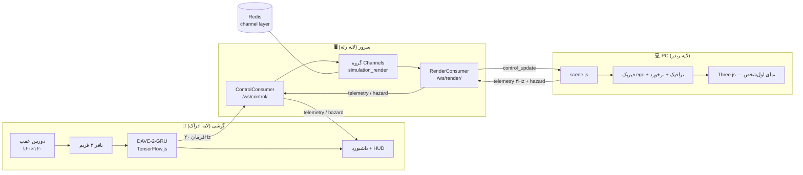

# راهنمای SelfDriveSim — نسخه ۱٫۰

## فهرست

| بخش | موضوع |
|---|---|
| [۱](#۱-معرفی) | معرفی |
| [۲](#۲-پیشنیازها) | پیش‌نیازها |
| [۳](#۳-نصب-و-اجرا) | نصب و اجرا |
| [۴](#۴-اتصال-گوشی-با-فلگ-chrome) | اتصال گوشی (فلگ Chrome) |
| [۵](#۵-معماری-و-پروتکل-websocket) | معماری و پروتکل WebSocket |
| [۶](#۶-فیزیک-صحنه-و-hud) | فیزیک صحنه و HUD |
| [۷](#۷-مدل-dave-2-gru-و-پایپ‌لاین-تبدیل) | مدل DAVE-2-GRU و پایپ‌لاین تبدیل |
| [۸](#۸-عیب‌یابی) | عیب‌یابی |
| [۹](#۹-تست‌ها) | تست‌ها |
| [۱۰](#۱۰-نتایج-و-محدودیت‌ها) | نتایج و محدودیت‌ها |
| [۱۱](#۱۱-مدل-نامزد-آموزش-و-ارزیابی-آفلاین-stage-2) | نامزد Stage 2 و ارزیابی آفلاین |

## ۱. معرفی

شبیه‌ساز حلقه‌بستهٔ رانندگی خودران روی سخت‌افزاری که از قبل دارید: یک PC، یک گوشی و یک
شبکهٔ Wi-Fi محلی.

صحنهٔ Three.js روی PC یک جادهٔ سه‌لاین بی‌پایان با ترافیک روبه‌رو را تمام‌صفحه رندر می‌کند.
گوشی روی استند، روبه‌روی مانیتور، از پشت دوربین عقب خودش همان صفحه را می‌بیند. در مرورگر
گوشی — بدون نصب اپ و بدون GPU سمت سرور — شبکهٔ DAVE-2-GRU با TensorFlow.js اجرا می‌شود،
سه فریم آخر دوربین را تحلیل می‌کند و چهار فرمان می‌سازد: `steering` (−۱ تا ۱)، `throttle`
(۰ تا ۱)، `brake` (۰ تا ۱) و `turn_signal` (۰ خاموش / ۱ چپ / ۲ راست). فرمان‌ها از WebSocket
و Django Channels می‌گذرند و خودرو در صحنه آن‌ها را با یک مدل سینماتیک ساده اعمال می‌کند:
گاز، ترمز، اصطکاک، فرمان، راهنمای چشمک‌زن با ۳ تغییر وضعیت در ثانیه، ساییدن به دیوار
نامرئی و برخورد با ترافیک. سرعت و هشدارها به گوشی برمی‌گردند و حلقه بسته می‌شود.

هیچ فریمی از گوشی خارج نمی‌شود؛ فقط چهار عدد کنترل روی شبکهٔ محلی جابه‌جا می‌شوند.

```
 ┌───────────────────────── PC ─────────────────────────┐      ┌────────────────── Phone ──────────────────┐
 │                                                      │      │                                           │
 │  Three.js first-person scene  ←── control_update ──┐ │      │  rear camera (160×120 frames)             │
 │   • ego physics (speed/heading)                   │ │      │        ↓ 3-frame window                   │
 │   • traffic, collisions, walls                    │ │      │  DAVE-2-GRU in TensorFlow.js (browser)    │
 │   • HUD: speed, heading, signals, counters        │ │      │        ↓ 20 Hz                            │
 │        ↓ telemetry 4 Hz, hazards                  │ │      │  steering · throttle · brake · turn_signal│
 └──────────────┬────────────────────────────────────┼─┘      └───────────────┬───────────────────────────┘
                │              ┌─────────────────────┘                        │ control frames
                │              │ /ws/render/                                  │ /ws/control/
                └──────────────┤ Django Channels + Daphne (ASGI) ←────────────┘
                               │   validation · clipping · group fan-out
                               └───────────────┬─────────────────────────────
                                               │
                                        [( Redis channel layer )]
```

## ۲. پیش‌نیازها

- **Python 3.11** — نسخهٔ تست‌شده. Ubuntu 22.04 نسخهٔ ۳٫۱۰ و Ubuntu 24.04 نسخهٔ ۳٫۱۲ دارد؛
  برای ۳٫۱۱ از PPA استفاده کنید:
  `sudo add-apt-repository ppa:deadsnakes/ppa && sudo apt install python3.11 python3.11-venv`.
- **Redis 6+** — لایهٔ کانال Channels که فریم‌ها را بین مصرف‌کننده‌های WebSocket پخش می‌کند.
- **مرورگر مدرن** — Chrome/Edge روی PC و Chrome اندروید روی گوشی، Firefox، Safari 16+.
- **Node.js 20.11+** *(اختیاری)* — برای تست‌های فرانت‌اند، جمع‌آوری دیتاست و بازسازی استایل Tailwind.
- **فقط برای پایپ‌لاین مدل:** Linux/macOS (برای TensorFlow در ویندوز چرخ وجود ندارد؛ از WSL2
  استفاده کنید).

## ۳. نصب و اجرا

همهٔ دستورها از پوشهٔ `selfdriving_sim/` اجرا می‌شوند.

### ۳.۱ Redis

```bash
sudo apt update
sudo apt install -y redis-server
sudo systemctl enable --now redis-server
redis-cli ping   # PONG
```

### ۳.۲ محیط مجازی و وابستگی‌ها

```bash
python3.11 -m venv .venv
source .venv/bin/activate          # Windows: .venv\Scripts\activate
pip install --upgrade pip
pip install -r requirements.txt
python manage.py migrate
```

بسته‌های TensorFlow در `requirements.txt` فقط روی Linux و macOS نصب می‌شوند؛ کاربر ویندوز
کل زنجیرهٔ ML را داخل WSL2 اجرا کند. برای سرور و تست‌های وب نیازی به TensorFlow نیست.

### ۳.۳ تنظیمات محلی (اختیاری)

فایل `.env` در همین پوشه مقادیر پیش‌فرض را بازنویسی می‌کند. متغیرهای محیطی واقعی بر فایل
اولویت دارند.

| متغیر | پیش‌فرض | کارکرد |
|---|---|---|
| `DJANGO_SECRET_KEY` | مقدار موقت توسعه | کلید رمزنگاری Django؛ بیرون از توسعه مقدار واقعی بگذارید. |
| `REDIS_HOST` | `127.0.0.1` | میزبان Redis برای لایهٔ کانال. |
| `REDIS_PORT` | `6379` | پورت Redis. |
| `DJANGO_CSRF_TRUSTED_ORIGINS` | خالی | مبدأهای مجاز اضافه، جداشده با کاما. |
| `SIMULATION_CONTROL_LOG_LEVEL` | `INFO` | لاگ کنسول برای فرمان‌های معتبر؛ `WARNING` جریان ۲۰ هرتزی را ساکت می‌کند. |
| `DJANGO_ALLOW_IFRAME_PREVIEW` | تنظیم‌نشده | فقط برای پیش‌نمایش تعبیه‌شدهٔ توسعه؛ همراه `DEBUG` محافظ X-Frame-Options را برمی‌دارد. |

### ۳.۴ راه‌اندازی سرور

ساده‌ترین راه، لانچر است: Redis را بررسی می‌کند، مهاجرت‌ها را می‌زند، فایل‌های استاتیک را
جمع می‌کند و آدرس‌های PC و گوشی (به‌همراه IP داخلی شناسایی‌شده) را چاپ می‌کند:

```bash
./scripts/run.sh      # Linux/macOS
scripts\run.bat       # Windows
```

معادل دستی:

```bash
python manage.py runserver 0.0.0.0:8000
```

`runserver` پروژه را در `ASGIStaticFilesHandler` می‌پیچد و HTTP، WebSocket و فایل‌های
استاتیک را با هم سرو می‌کند. Daphne مستقل (`daphne -b 0.0.0.0 -p 8000
selfdriving_sim.asgi:application`) فایل‌های استاتیک را سرو **نمی‌کند**؛ در آن حالت
`python manage.py collectstatic` بزنید و `staticfiles/` را با یک وب‌سرور کنار Daphne سرو
کنید.

| مسیر | توضیح |
|---|---|
| `GET /` | صحنهٔ Three.js (روی PC، تمام‌صفحه با F11). |
| `GET /dashboard/` | داشبورد موبایل راست‌به‌چپ که مدل را در مرورگر اجرا می‌کند. |
| `GET /health/` | `{"status": "ok", "version": "1.0.0"}`. |
| `/admin/` | پنل ادمین Django. |
| `/ws/control/` | WebSocket گوشی. |
| `/ws/render/` | WebSocket صفحهٔ Three.js. |

### ۳.۵ ساختار مخزن

```
SelfDriveSim/
├── README.md                    معرفی کوتاه و اجرای سریع
└── selfdriving_sim/
    ├── manage.py
    ├── requirements.txt
    ├── package.json             ساخت CSS و اجرای تست‌های فرانت‌اند
    ├── pytest.ini, playwright.config.js, conftest.py
    ├── scripts/                 run.sh / run.bat
    ├── selfdriving_sim/         تنظیمات، ورودی ASGI/WSGI، URLهای ریشه
    ├── simulation/              صحنه: صفحه، مصرف‌کننده‌ها، scene.js، تست‌ها
    ├── client/                  گوشی: داشبورد، دوربین + inference.js،
    │                            مدل تبدیل‌شدهٔ DAVE-2-GRU، TF.js محلی، تست‌ها
    ├── models/                  دانلود checkpoint → گسترش → تبدیل به TF.js
    └── docs/
        ├── guide.fa.md          همین سند
        └── guide.en.md          نسخهٔ انگلیسی
```

## ۴. اتصال گوشی با فلگ Chrome

دوربین در مرورگر فقط در «Context امن» کار می‌کند: `https://` یا `http://localhost`. آدرس
`http://<IP-دیگر>:8000` روی گوشی به‌طور پیش‌فرض دوربین نمی‌دهد. راه رسمی این پروژه، فعال‌کردن
فلگ Chrome است؛ هیچ تونل اینترنتی و هیچ سرویس بیرونی لازم نیست و ترافیک دوربین و فرمان
کامل روی شبکهٔ محلی می‌ماند.

### ۴.۱ گام‌به‌گام

۱. **هر دو دستگاه روی یک Wi-Fi.** IP داخلی PC را پیدا کنید:
   - لینوکس/مک: `hostname -I` (اولین آدرس غیر از `127.0.0.1`)
   - ویندوز: `ipconfig` (قسمت `IPv4 Address` همان آداپتور Wi-Fi)
   مثال: `192.168.1.42`. مطمئن شوید گوشی و PC روی یک شبکه و بدون «AP Isolation» هستند.

۲. **سرور را روی همهٔ اینترفیس‌ها بالا بیاورید** (با `runserver`، چون استاتیک‌ها را سرو
   می‌کند):

   ```bash
   python manage.py runserver 0.0.0.0:8000
   ```

۳. **فلگ را در Chrome گوشی فعال کنید.** در نوار آدرس گوشی باز کنید:

   ```
   chrome://flags/#unsafely-treat-insecure-origin-as-secure
   ```

   - روی **Enabled** بگذارید.
   - در کادر متنی، **دقیقاً** آدرس مبدأ خودتان را بنویسید:
     `http://192.168.1.42:8000` (با پورت، بدون `/dashboard/` و بدون اسلش انتهایی).
   - دکمهٔ **Relaunch** را بزنید تا Chrome دوباره باز شود. (اگر دکمه نبود، Chrome را کامل
     ببندید و از نو باز کنید.)

۴. **داشبورد را باز کنید.** در Chrome گوشی:

   ```
   http://192.168.1.42:8000/dashboard/
   ```

   درخواست دوربین را **Allow** کنید، گوشی را روی استند و روبه‌روی مانیتور ثابت کنید،
   سپس **«شروع خودران»** را بزنید. نشانگر «ارتباط با شبیه‌ساز» باید سبز شود و نرخ ارسال
   به حدود ۲۰ FPS برسد. روی PC صفحهٔ `/` را تمام‌صفحه (F11) نگه دارید.

۵. **عیب‌یابی این روش**
   - بعد از آپدیت‌های بزرگ Chrome، لیست فلگ‌ها ریست می‌شود؛ اگر پیام «اتصال امن لازم است»
     برگشت، گام ۳ را تکرار کنید.
   - **AP Isolation** روی روترهای مهمان خیلی رایج است: گوشی به PC دیده نمی‌شود. راه‌های
     جایگزین: شبکهٔ اصلی بدون isolation، یا **هات‌اسپات خود گوشی** و وصل‌کردن PC به آن
     (در آن حالت IP جدید را از `hostname -I`/`ipconfig` بگیرید و فلگ را برای همان آدرس
     به‌روز کنید).
   - **فایروال ویندوز** برای پورت ۸۰۰۰: در ویندوز اولین اجرای Python اجازهٔ شبکه می‌خواهد؛
     اگر رد شد، در Windows Defender Firewall یک Inbound Rule برای TCP 8000 بسازید.
   - **iOS این فلگ را ندارد.** Safari روی iPhone راهی برای امن‌کردن مبدأ ناامن ندارد؛
     برای iOS از پیوست زیر استفاده کنید.
   - اگر فلگ کار نکرد، ترتیب را چک کنید: Enabled ← آدرس در کادر ← Relaunch ← بعد باز کردن
     داشبورد. تب قدیمی که قبل از Relaunch باز شده است، فلگ را نمی‌بیند.

۶. **پیوست — راه پایدارتر (iOS و تنظیم دائمی):** یک پروکسی معکوس محلی با گواهی داخلی،
   بدون هیچ سرویس بیرونی. با [Caddy](https://caddyserver.com/) یک فایل `Caddyfile`:

   ```caddyfile
   https://192.168.1.42 {
       tls internal
       reverse_proxy 127.0.0.1:8000
   }
   ```

   `caddy run` را اجرا کنید، گواهی ریشه (`root.crt` از پوشهٔ data کدی) را روی گوشی نصب و
   در تنظیمات Trust کنید، و داشبورد را روی `https://192.168.1.42/dashboard/` باز کنید.
   این مسیر مبدأ امن واقعی می‌سازد، برای iOS هم کار می‌کند و WebSocket را به‌طور خودکار
   به `wss://` می‌برد.

### ۴.۲ رفتار داشبورد موبایل

داشبورد دوربین عقب را ترجیح می‌دهد (`facingMode: { ideal: "environment" }`، عرض مطلوب
۱۲۸۰)، یک `canvas` مخفی ۱۶۰×۱۲۰ (اندازهٔ ورودی مدل)، غربیلک، فلش‌های راهنما، نشانگرهای
گاز و ترمز و دکمه‌های شروع/توقف دارد. بعد از موفقیت مجوز دوربین، اتصال
`/ws/control/` باز می‌شود (روی صفحهٔ HTTPS با `wss:`، روی HTTP با `ws:`). آدرس سوکت از
`location.host` ساخته می‌شود؛ در کد هیچ `localhost` یا IP ثابتی وجود ندارد. تا زمانی که
**شروع خودران** زده نشود، هیچ فریمی ارسال نمی‌شود.

- حلقهٔ ۵۰ میلی‌ثانیه‌ای مدل را روی سه فریم جدید اجرا می‌کند و فقط چهار مقدار کنترل
  می‌فرستد؛ تصویر روی گوشی می‌ماند.
- مدل قبل از دوربین بارگذاری می‌شود (`data-model-url`)، در حال بارگذاری `MODEL LOADING`
  نشان داده می‌شود و اگر بارگذاری شکست بخورد، به Mock برمی‌گردد (نشانگر `MOCK MODE`).
  فرمان‌های Mock سینوسی و تکرارپذیرند و برای تست صحنه‌اند، نه رانندگی واقعی.
- FPS نرخ `send` موفق مرورگر است، نه فریم دوربین و نه تأیید دریافت سرور. سرعت نمایش‌داده‌شده
  سرعت خودروی صحنه است و از `/ws/render/` می‌آید؛ تا وقتی صفحهٔ شبیه‌ساز وصل نباشد «—»
  می‌ماند.
- تلومتری سرعت خوانش را به‌روز می‌کند؛ فریم هشدار `hazard` بنر قرمز چهارثانیه‌ای
  («برخورد با دیوار — مسیر را عوض کن») را نشان می‌دهد. `parseHazard` فقط `collision` و
  `wall` را می‌پذیرد.
- قطع دوربین، خطای ثبت تصویر، پاسخ خطای سرور، قطع ارتباط یا انباشته‌شدن بیش از ۱۰۲۴ بایت
  در صف سوکت (`bufferedAmount`) ارسال را متوقف می‌کند.
- تلاش مجدد WebSocket با فاصله‌های ۰٫۵، ۱، ۲، ۴، ۸ و سپس سقف ۱۵ ثانیه انجام می‌شود؛ هر
  handshake پس از ۱۰ ثانیه بی‌پاسخ بسته می‌شود و پس از ۱۰ تلاش دکمهٔ **اتصال مجدد** ظاهر
  می‌شود. بازگشت ارتباط **هرگز** ارسال را خودکار شروع نمی‌کند.
- با پنهان‌شدن صفحه یا `pagehide` حلقه و تایمرها پاک، سوکت بسته و همهٔ trackهای دوربین
  آزاد می‌شوند. دارایی‌ها (CSS، فونت وزیرمتن، TF.js، مدل) کاملاً محلی‌اند و صفحه هیچ
  درخواست شبکهٔ بیرونی ندارد.

**محدودیت ایمنی:** ارسال «توقف» best-effort و بدون acknowledgment است؛ اگر ارتباط قطع باشد
رسیدن آن تضمین نمی‌شود. این پروژه شبیه‌ساز است، نه کنترل وسیلهٔ نقلیهٔ واقعی.

### ۴.۳ لاگ سرور

هر فرمان معتبر یک خط لاگ می‌دهد:

```text
INFO simulation.consumers: Control /ws/control/ steering=0.250 throttle=0.600 brake=0.000 turn_signal=1
```

فقط چهار مقدار اعتبارسنجی‌شده و clip‌شده لاگ می‌شوند؛ هیچ تصویر یا payload اضافی ثبت
نمی‌شود. برای ساکت‌کردن جریان ۲۰ هرتزی:

```bash
SIMULATION_CONTROL_LOG_LEVEL=WARNING python manage.py runserver 0.0.0.0:8000
```

### ۴.۴ ساخت CSS محلی

خروجی کامپایل‌شدهٔ CSS در مخزن هست و برای اجرای معمول سرور Node لازم نیست. برای تغییر ظاهر:

```bash
npm ci
npm run build:css
npm run watch:css        # اختیاری، در ترمینال جدا
```

فایل منبع `client/styles/dashboard.css` و فایل سرو‌شده
`client/static/client/css/dashboard.css` است؛ بعد از تغییر کلاس‌های template یا JavaScript
دوباره بسازید و خروجی را کامیت کنید. اطلاعات و مجوز وزیرمتن در
`client/static/client/fonts/` است.

## ۵. معماری و پروتکل WebSocket



### ۵.۱ لایه‌ها

| لایه | جزء | فایل | نقش |
|---|---|---|---|
| موبایل | دوربین | `getUserMedia` با ترجیح `environment` | ویدیوی زندهٔ مانیتور |
| موبایل | نمونه‌بردار | `canvas` مخفی ۱۶۰×۱۲۰ در `inference.js` | کوچک‌سازی هر فریم به ورودی مدل (پیکسل خام ۰..۲۵۵) |
| موبایل | استنتاج | `inference.js` + `reset-after-gru.js` + `tf.min.js` | GRU سفارشی با `reset_after=True` که tfjs ندارد؛ حلقهٔ ۵۰ms |
| شبکه | ASGI | `selfdriving_sim/asgi.py` + Daphne | HTTP و WebSocket روی یک پورت |
| شبکه | مصرف‌کننده‌ها | `simulation/consumers.py` | `ControlConsumer` (گوشی) و `RenderConsumer` (صحنه) |
| شبکه | گروه | `simulation_render` | fan-out بین همهٔ اعضا؛ چند پروسه با یک Redis کار می‌کنند |
| PC | صحنه | `simulation/static/simulation/js/scene.js` | ساخت دنیا، فیزیک ego، ترافیک، برخورد، HUD، چشمک‌زن |
| PC | رندرر | Three.js r160 (محلی) | نمای اول‌شخص روی سپر جلو، سایه، مه |
| PC | ورودی دستی | کیبورد ↑↓←→ / WASD | وقتی بیش از ۰٫۵ ثانیه فرمان تازه نرسد، کیبورد می‌راند |

### ۵.۲ پیام‌ها

هر دو endpoint عضو گروه `simulation_render` هستند (echo نزد فرستنده drop می‌شود تا حلقهٔ
محلی شکل نگیرد).

| نوع پیام | مسیر | تواتر | ساختار | اعتبارسنجی |
|---|---|---|---|---|
| فرمان رانندگی | گوشی → `/ws/control/` → گروه → `/ws/render/` → صحنه | ~۲۰Hz | `{"steering":…, "throttle":…, "brake":…, "turn_signal":…}` | clip به بازه‌های پروتکل |
| تلومتری | صحنه → `/ws/render/` → گروه → گوشی | ۴Hz | `{"type":"telemetry","speed_kmh":…}` | clip به ۰..۴۰۰ |
| هشدار | صحنه → `/ws/render/` → گروه → گوشی | رویدادی | `{"type":"hazard","hazard":"collision"\|"wall"}` | فقط انواع مجاز |
| خطا | سرور → فرستندهٔ همان سوکت | رویدادی | `{"type":"error","message":"…"}` | — |

بازه‌های کنترل: `steering` در −۱..۱، `throttle` و `brake` در ۰..۱ و `turn_signal` روی
۰/۱/۲ (پس از clip به عدد صحیح گرد می‌شود). JSON خراب، فیلد گمشده یا مقدار غیرعددی رد
می‌شود، پیام خطا فقط به فرستنده می‌رود و اتصال باز می‌ماند. `sanitize_telemetry` و
`sanitize_hazard` همین کار را برای مسیر معکوس انجام می‌دهند.

فریم کنترل روی صفحهٔ PC:

```json
{"type": "control_update", "steering": 0.25, "throttle": 0.6, "brake": 0.0, "turn_signal": 1}
```

صحنه فریم‌هایی که `type` آن‌ها `control_update` نیست نادیده می‌گیرد و فریمی که فیلدهایش عدد
نیستند را دور می‌ریزد.

### ۵.۳ چرخهٔ حیات یک فریم

برای یک تیک حلقهٔ ۵۰ میلی‌ثانیه‌ای گوشی:

1. **ثبت (۰–۵ms):** `drawImage` ویدیو را به canvas مخفی ۱۶۰×۱۲۰ می‌کشد؛ پیکسل‌ها همان‌جا
   می‌مانند.
2. **پنجره‌بندی:** فریم به بافر اضافه می‌شود؛ مدل همیشه روی **۳ فریم جدید** کار می‌کند
   (پنجره ≈ ۱۵۰ms گذشته).
3. **استنتاج (~۱۰–۳۰ms روی میان‌ردهٔ مدرن):** TimeDistributed-CNN → GRU(128) → چهار head.
4. **کلمپ و ارسال (<۱ms):** `toCommand` بازه‌ها را تضمین می‌کند؛ یک فریم JSON به
   `/ws/control/` می‌رود.
5. **رلهٔ سرور (<۱–۳ms روی LAN):** sanitize → `group_send` → Redis → `RenderConsumer` →
   صفحه.
6. **فیزیک صحنه (در فریم بعدی `requestAnimationFrame`):** `applyControls` فرمان را ذخیره
   می‌کند؛ سپس با `dt = min(clock.getDelta(), 0.1)`: سرعت → heading → موقعیت → دیوار → مش.
7. **برخورد و HUD:** `Box3` با هر ترافیک فعال؛ رویداد ⇒ فلاش + هشدار؛ HUD با ۴Hz به‌روز
   می‌شود.
8. **رندر:** دوربین روی سپر جلو و ۳۰ واحد جلوتر را نگاه می‌کند؛ جادهٔ بی‌پایان با snap به
   دورهٔ خط‌چین جلو می‌رود.
9. **بازخورد:** هر ۰٫۲۵ ثانیه تلومتری سرعت به گوشی می‌رسد.

زنجیرهٔ کامل (دوربین تا پیکسل) روی LAN معمولاً **۶۰–۱۲۰ms** است؛ تجزیه و کاهش آن در
[عیب‌یابی](#۸-عیب‌یابی) آمده است.

### ۵.۴ قرارداد پایداری

- فرمان کهنه (بیش از `COMMAND_FRESH_S = 0.5s`) نادیده گرفته می‌شود ⇒ قطعی شبکه خودرو را
  متوقف نمی‌کند، کیبورد برمی‌گردد.
- قطع `/ws/render/` ⇒ backoff نمایی ۰٫۵ تا سقف ۱۵ ثانیه، حداکثر ۱۰ تلاش، سپس وضعیت قرمز در
  HUD تا بارگذاری مجدد صفحه.
- شروع/توقف استنتاج فقط با دکمه‌های صریح داشبورد؛ توقف یک فرمان ترمز کامل best-effort
  می‌فرستد و تضمین ایمنی نیست.

## ۶. فیزیک صحنه و HUD

### ۶.۱ خودرو

خودرو `{x, z, speed, heading}` را در فضای جهانی نگه می‌دارد و به سمت `−z` می‌راند. در هر
فریم با `dt = min(clock.getDelta(), 0.1)`:

| گام | قاعده |
|---|---|
| طولی | `brake > 0.1` ⇒ `speed -= 20·brake·dt`؛ وگرنه `throttle > 0.1` ⇒ `speed += 8·throttle·dt`؛ وگرنه اصطکاک ثابت `2 m/s²`. کلیپ در `0…20 m/s`. |
| چرخش | فقط بالای `0.5 m/s`: `heading += steering · 1.5 · min(1, speed/5) · dt` |
| موقعیت | `x += sin(heading)·speed·dt`, `z -= cos(heading)·speed·dt` |
| دیوار | `\|x\| ≤ 9` کلیپ می‌شود؛ ساییدن ۱۵ m/s² از سرعت کم می‌کند و رویداد `wall` ثبت می‌شود |
| برخورد | هم‌پوشانی `Box3` با ترافیک ⇒ فلاش قرمز، توقف کامل، شمارنده، حدود ۱ ثانیه انجماد و بازگشت به مرکز لاین وسط با ۲ ثانیه مصونیت |
| راهنما | `blinkerPhase += dt·3` و toggle روی `floor(phase) % 2` — سه تغییر وضعیت در ثانیه |

`STEERING_SIGN = 1` فرمان مثبت مدل را روی پیچ به **راستِ تصویر** می‌نشاند. جلو = `−z` تا
راستِ تصویر = `+x` دنیا باشد؛ با این قرارداد فرمان مثبت DAVE-2 با انحنای جاده هم‌جهت است.
اگر تست واقعی عکس این را نشان داد، همان یک ثابت در `scene.js` به `-1` تغییر می‌کند.

### ۶.۲ دنیا

- جادهٔ مستقیم و **بی‌پایان** سه‌لاین، ۲۰ واحد عرض، خط‌چین لاین‌ها، خط لبه و گاردریل.
  گروه جاده به نزدیک‌ترین مضربِ دورهٔ خط‌چین (۶ واحد) جلو می‌رود، پس پرش دیده نمی‌شود.
- درخت و چراغ خیابان در دو طرف که پس از عبور یک span جلوتر بازیافت می‌شوند؛ خورشید
  سایه‌انداز همراه خودرو جابه‌جا می‌شود.
- ترافیک روبه‌رو با رنگ‌های قرمز، زرد، سبز و نارنجی: هر ۲٫۵ تا ۴٫۵ ثانیه، ۱۵۰ تا ۲۰۰ واحد
  **جلوی** خودرو در لاینی تصادفی spawn می‌شود، با ۹ تا ۲۱ واحد بر ثانیه به سمت ما می‌آید،
  حداکثر ۲۰ خودرو هم‌زمان و حداقل ۲۵ واحد فاصله در یک لاین، و ۱۵ واحد پشت سر ما بازیافت
  می‌شود.
- دوربین اول‌شخص روی سپر جلو در ارتفاع ۰٫۷۵ می‌نشیند و ۳۰ واحد جلوتر را با افق تراز
  می‌بیند؛ بدنهٔ خودروی خودمان نامرئی است. چراغ‌های راهنما دو مکعب زرد در لبهٔ کاپوت‌اند که
  والد دوربین‌اند و فلش‌های ◀/▶ در HUD با همان ریتم روشن می‌شوند.
- هشدارها دو مسیره‌اند: فلاش تمام‌صفحه روی مانیتور (که دوربین گوشی می‌بیند و برای شبکه
  قابل مشاهده است) و فریم `hazard` روی WebSocket (که بنر داشبورد را نشان می‌دهد).

### ۶.۳ HUD و کنترل دستی

| عنصر | نمایش |
|---|---|
| `#ws-status` | `وصل` سبز، `قطع` قرمز و شمارهٔ تلاش در حال اتصال مجدد |
| `#speed-value` | سرعت خودرو در km/h |
| `#heading-value` | زاویه در درجه، `(-180, 180]` |
| `#turn-left` / `#turn-right` | فلش‌های هم‌گام با لامپ‌های سه‌بعدی |
| `#collision-count` / `#wall-count` | شمارندهٔ برخورد و ساییدگی دیوار (بالای صفر قرمز) |
| `#fps-value` | نرخ فریم هموارشده |
| `#hazard-flash` | فلاش تمام‌صفحه: قرمز «برخورد!» و نارنجی «برخورد با دیوار — مسیر را عوض کن» |

کیبورد هر وقت بیش از ۰٫۵ ثانیه فرمان تازه از گوشی نرسد می‌راند: `↑`/`W` گاز، `↓`/`S`
ترمز، `←`/`→` یا `A`/`D` فرمان. `window.applyControls(command)` نقطهٔ ورود سوکت رندر است.

Three.js r160 (`three@0.160.1`) به‌صورت محلی در `simulation/static/simulation/js/vendor/`
کامیت شده تا صفحه روی LAN بدون اینترنت کار کند؛ هش و مراحل به‌روزرسانی در README همان
پوشه است.

## ۷. مدل DAVE-2-GRU و پایپ‌لاین تبدیل

گوشی خودش مدل را اجرا می‌کند. TensorFlow.js 4.22.0 (`@tensorflow/tfjs`) در
`client/static/client/js/vendor/` کنار برنامه است، مانند Three.js، پس داشبورد به CDN و
اینترنت نیاز ندارد. مدل تبدیل‌شده در `client/static/client/models/dave2/` سرو می‌شود و
آدرسش در `data-model-url` داشبورد می‌آید.

### ۷.۱ منبع مدل

| | |
|---|---|
| مخزن | [`maxim-igenbergs/dave2-gru`](https://huggingface.co/maxim-igenbergs/dave2-gru) روی Hugging Face |
| Revision | `dddcf9fc24fc258bb809f276c021d4c66aa4ceb5` (pinشده در `dave2_config.HF_REVISION`) |
| checkpoint پیش‌فرض | `genroads_20251215-174930/best_model.h5` — `33,328,880` بایت |
| SHA-256 | `fbee0740ce53b0ad7be35b708c0242fc98143699f8f7024af0d21d28719a32bf` |
| جایگزین | `jungle_20251201-142321/best_model.h5` (`--checkpoint jungle`) |
| کد آموزش | [`MaximIgenbergs/thesis-robust-e2e-vision-ads`](https://github.com/MaximIgenbergs/thesis-robust-e2e-vision-ads)، `scripts/udacity/models/dave2_gru/` |

فایل یک مدل Keras 2 در قالب HDF5 است (توپولوژی و وزن‌ها با هم) که TensorFlow 2.9 نوشته
است. `meta.json` آن ورودی را `[3, 120, 160, 3]`، `seq_len 3`، Adam با `1e-4` و
`alpha_steer 0.7` ثبت کرده است. دیاگرام `66 × 200` روی کارت مدل با وزن‌های آموزش‌دیده
نمی‌خواند؛ `dave2_config.py` از `meta.json` پیروی می‌کند.

اگر حجم فایل دانلودی حدود ۱۳۳ بایت بود، آن فایل **اشاره‌گر Git LFS** است نه مدل؛ از لینک
مستقیم `resolve` یا دکمهٔ Download استفاده کنید. `models/data/` و `*.h5` در `.gitignore`
هستند و کامیت نمی‌شوند؛ فقط مدل تبدیل‌شده (حدود ۵٫۵ مگابایت) در مخزن است تا یک clone
بتواند بدون TensorFlow داشبورد را سرو کند.

### ۷.۲ معماری و قرارداد

```text
seq_img_in (3, 120, 160, 3)          سه فریم RGB پشت‌سرهم، پیکسل خام 0..255
└─ td_backbone  TimeDistributed(dave2_backbone)
   ├─ norm      Lambda(t / 255.0)     نرمال‌سازی پیکسل
   ├─ conv2d_1..5  24, 32, 64, 64, 64 فیلتر، relu، dropout 0.1 بین آن‌ها
   └─ flattened
├─ gru          128 واحد، reset_after=True، dropout 0.1
├─ fc_100, fc_50  relu
└─ outputs      Dense(2, linear)      [steering, throttle]
```

ورودی و خروجی همان‌طور که گوشی می‌بیند (پس از `extend_model.py`):

- **ورودی** `(batch, 3, 120, 160, 3)`، RGB با مقادیر **۰..۲۵۵**. فریم‌های یک پنجره پیوسته‌اند
  (`iter_windows` از `frames[start:start + seq_len]` استفاده می‌کند؛ `stride` گام بین شروع
  پنجره‌هاست). در حلقهٔ ۲۰ Hz داشبورد، پنجره ۱۵۰ میلی‌ثانیه از گذشته را پوشش می‌دهد.
- **خروجی‌ها** به این ترتیب:

| head | فعال‌ساز | بازه | منبع |
|---|---|---|---|
| `steering` | linear | حدود −۱..۱، روی گوشی clamp می‌شود | وزن آموزش‌دیده، ستون ۰ |
| `throttle` | linear | حدود ۰..۱، روی گوشی clamp می‌شود | وزن آموزش‌دیده، ستون ۱ |
| `brake` | sigmoid | ۰ | ثابت خنثی، بدون سیگنال آموزشی |
| `turn_signal` | softmax روی ۳ | کلاس ۰ = خاموش | ثابت خنثی، بدون سیگنال آموزشی |

checkpoint روی لاگ‌های شبیه‌ساز Udacity آموزش دیده که برچسب‌هایش `user/angle` و
`user/throttle` است؛ برچسب ترمز یا راهنما در آن داده نبوده، پس این دو head از خروجی ثابت
خنثی شروع می‌شوند (وزن تصادفی ترمز باعث ترمزگیری تصادفی می‌شد). lossها متصل‌اند تا
fine-tune در آینده ممکن باشد.

### ۷.۳ دستورها

همهٔ دستورها از `selfdriving_sim/` و با venv فعال:

```bash
pip install -r requirements.txt        # یک‌بار: TensorFlow، tf-keras و tensorflowjs
npm ci                                 # یک‌بار: TensorFlow.js برای تست‌ها و parity

python models/download_model.py        # دریافت، یا بررسی فایل دستی‌گذاشته‌شده
python models/extend_model.py          # چهار head + بازسازی گراف، با بررسی عددی
python models/convert.py               # تبدیل به TF.js با وزن‌های float16

# اختیاری: اثبات اینکه مدل مرورگر همان چیزی را می‌سازد که Keras می‌سازد
python models/parity/export_reference.py
node models/parity/compare_tfjs.mjs
```

`download_model.py` وقتی `models/data/<folder>/best_model.h5` موجود باشد به شبکه دست
نمی‌زند؛ اندازه و SHA-256 را بررسی می‌کند و همان فایل را برمی‌دارد. `convert.py` اندازهٔ هر
فایل را چاپ می‌کند و اگر مجموع به `MAX_WEB_MODEL_BYTES` (۱۰ مگابایت) برسد شکست می‌خورد؛
پوشهٔ خروجی را قبل از تبدیل و نیز پس از شکست پاک می‌کند تا مدل ناقص یا سنگین کامیت نشود.

### ۷.۴ تصمیم‌های فنی

۱. **گراف برای مرورگر بازسازی شده، بدون تغییر در محاسبات.** `tfjs-layers` نه لایهٔ `Lambda`
   دارد و نه می‌تواند مدل تودرتو را داخل `TimeDistributed` deserialize کند؛ checkpoint هر
   دو را دارد. پس هر لایهٔ backbone یک `TimeDistributed` مستقل می‌گیرد و Lambda حذف می‌شود.
۲. **نرمال‌سازی در کرنل اولین کانولوشن fold شده.** چون `W·(s·x) + b == (W·s)·x + b`، تقسیم
   بر ۲۵۵ داخل کرنل `conv2d_1` رفت و قرارداد ورودی دقیقاً همان پیکسل خام ماند. مقدار `s` از
   خود checkpoint اندازه‌گیری می‌شود (فریم ثابت ۲۵۵ و ۱۲۸ به لایهٔ نرمال‌سازی داده می‌شود) و
   اگر ضرب ساده نباشد اسکریپت به‌جای حدس‌زدن خطا می‌دهد. به همین دلیل
   `client/static/client/js/inference.js` **نباید** بر ۲۵۵ تقسیم کند.
۳. **`steering` و `throttle` خطی ماندند.** افزودن `tanh`/`sigmoid` مقادیر آموزش‌دیده‌ای را
   که خودشان در بازهٔ پروتکل‌اند squash می‌کرد (`tanh(1) == 0.76` و
   `sigmoid(0) == 0.5`، یعنی خودروی همیشه‌گاز). به‌جایش گوشی clamp می‌کند (`toCommand`).
۴. **`brake` و `turn_signal` خنثی شروع می‌شوند:** ترمز `sigmoid(-20) ≈ 0` و راهنما softmax
   با logit بزرگ روی کلاس ۰.
۵. **GRU با `reset_after=True` در مرورگر.** `tfjs-layers` فقط `reset_after=False` را
   پیاده کرده؛ تغییر آن محاسبات شبکه را عوض می‌کند، پس لایهٔ سازگار با Keras در
   `client/static/client/js/reset-after-gru.js` نوشته شد که چیدمان وزن‌ها را یکسان نگه
   می‌دارد و فقط نام کلاس `GRU` را هنگام بارگذاری عوض می‌کند.
۶. **checkpoint با هر نسخهٔ پایتون خوانده می‌شود.** Keras لایهٔ `Lambda` را به‌صورت
   bytecode مارشال‌شده ذخیره می‌کند و bytecode فقط در همان نسخهٔ پایتون باز می‌شود؛ محیط
   آموزش TensorFlow 2.9 بود. اگر `load_model` با `bad marshal data` شکست بخورد،
   `models/checkpoint.py` توپولوژی را از JSON همان فایل بازسازی می‌کند (با lambdaای که این
   مخزن دارد) و وزن‌ها را با `load_weights` می‌خواند؛ پیش از آن بررسی می‌کند ثابت ۲۵۵ واقعاً
   در کد ذخیره‌شده هست، وگرنه به‌جای حدس‌زدن `--normalization-scale` می‌خواهد. خروجی هر دو
   مسیر بیت‌به‌بیت یکسان تست شد.

| فایل | کارکرد |
|---|---|
| `models/dave2_config.py` | تنها منبع حقیقت: pinها، قرارداد، نام headها، مسیرها، سقف حجم |
| `models/download_model.py` | دریافت از Hugging Face یا بررسی فایل دستی |
| `models/checkpoint.py` | بارگذاری checkpoint و بازسازی توپولوژی وقتی lambda خوانده نمی‌شود |
| `models/architecture.py` | بازسازی لایه‌ها از JSON توپولوژی داخل فایل |
| `models/extend_model.py` | flat کردن گراف، fold نرمال‌سازی، اتصال و بررسی چهار head |
| `models/convert.py` | اجرای `tensorflowjs_converter` با float16 و اعمال سقف حجم |
| `models/parity/` | صدور مرجع Keras و مقایسه با مدل تبدیل‌شده در TensorFlow.js |
| `models/tests/` | تست‌های بالا روی stand-inهای چندثانیه‌ای |

### ۷.۵ ساخت دیتاست محلی از شبیه‌ساز

چک‌پوینت فعلی تبدیل‌شدهٔ DAVE-2-GRU دست‌نخورده باقی مانده است. جمع‌آورندهٔ جداگانه،
اپیزودهای seedدار از صحنهٔ Three.js می‌سازد و در هر فریم چهار فرمان رانندهٔ اسکریپتی را ثبت
می‌کند. سیاست در خط حرکت می‌ماند، پیش از رفتن به خط مجاورِ امن راهنما می‌زند و وقتی هیچ خط
مجازی امنی در دسترس نباشد ترمز می‌گیرد. سرعت هدف هر اپیزود تصادفی و بین `10–15 m/s` است؛
ورود خودروی روبه‌رو هر `0.8–1.5 s`، در فاصلهٔ `55–115 m` و با سرعت `9–21 m/s` انجام می‌شود.
سیاست خطی را آزاد می‌داند که نزدیک‌ترین خودروی روبه‌رو حداقل `92 m` فاصله داشته باشد، وقتی
فاصلهٔ خط فعلی به `105 m` برسد مانور را شروع می‌کند، پیش از فرمان فرمان‌گیری `0.45 s` راهنما
می‌زند و اگر مانوری ممکن نباشد زیر فاصلهٔ `72 m` ترمز می‌گیرد. این‌ها فرض‌های سناریوی
اسکریپتی‌اند، نه کنترل‌گر ایمنی جاده‌ایِ اعتبارسنجی‌شده. فریم‌های برخورد و تماس با دیوار در
manifest نامعتبر علامت می‌خورند و مرحلهٔ افزایش دادهٔ دوربین آن‌ها را کنار می‌گذارد.

فرمان‌ها را از مسیر `selfdriving_sim/` و پس از `npm ci` اجرا کنید:

```bash
npm run dataset:collect -- --frames 512 --episode-frames 512 --seed 3001 \
  --output models/data/pilot-512

python -m venv .venv
.venv/bin/pip install -r requirements-data.txt
.venv/bin/python models/augment_dataset.py \
  --input models/data/pilot-512 \
  --output models/data/pilot-512-camera \
  --seed 91
```

برای اجرای ۵۰۰۰ فریمی، از `--frames 5000 --episode-frames 500` و یک پوشهٔ خروجی جدید استفاده
کنید. جمع‌آورنده با Chromium بدون رابط گرافیکی و رندر WebGL seedدار کار می‌کند؛ متغیر
`PLAYWRIGHT_CHROMIUM_EXECUTABLE_PATH` برای انتخاب مرورگر نصب‌شدهٔ محلی است. هر فریم خام یک
JPEG با اندازهٔ `640 × 360` است. فایل `manifest.jsonl` مسیر نسبی تصویر، مقادیر `steering`،
`throttle`، `brake` و `turn_signal`، وضعیت شبیه‌ساز و پرچم `valid` را نگه می‌دارد؛
`metadata.json` نیز seedها، نسخهٔ مرورگر، پروفایل‌های ظاهری و شمارش برچسب‌ها را ثبت می‌کند. داده‌ها در
`models/data/` ذخیره می‌شوند؛ این مسیر در git نادیده گرفته شده است. اجرای ۵۰۰۰ فریمی با seed
`20261014` تعداد ۴۶۹۹ نمای دوربین معتبر تولید کرد (۳۰۱ فریم برخورد/تماس با دیوار حذف شد).
پس از قرینه‌سازی افقی، شمار برچسب‌ها چنین بود: راهنمای خاموش ۲۴۶۸، چپ ۱۱۰۷، راست ۱۱۲۴ و
ترمز مثبت ۸۲۸. این داده یک نامزد آموزشی است، نه مجموعهٔ اعتبارسنجیِ کنارگذاشته‌شده و نه تضمین
پوشش شرایط واقعی.

در هر اپیزود رنگ آسمان، زمین، آسفالت و خط‌کشی، فاصلهٔ خط‌چین‌ها، بافت رویه، مناظر، شدت نور و
پایهٔ دوربین خودروی شبیه‌سازی‌شده تغییر می‌کند: میدان دید `54–70°`، ارتفاع چشم
`0.63–0.91 m`، یاو حداکثر `1.3°`، پیچ حداکثر `2.0°` و رول حداکثر `1.0°`. مرحلهٔ پایتون
تصویر رندرشده را به مانیتوری با پرسپکتیو مایل در قاب گوشی `4:3` با اندازهٔ `160 × 120`
نگاشت می‌کند و نوردهی، رنگ، بازتاب نور، نویز حسگر، تاری و کیفیت JPEG را تغییر می‌دهد. بعضی
نماها به‌صورت افقی قرینه می‌شوند و برچسب‌های فرمان، راهنما و موقعیت جانبی نیز همراه تصویر
قرینه می‌شوند.

این فقط تقریب نرم‌افزاری دوربین است، نه تصویربرداری واقعی: نرخ نوسازی نمایشگر، اتاق واقعی،
HUD، الگوی موآرهٔ صفحه یا لنز مشخص گوشی را بازسازی نمی‌کند. پیش از استفاده از همین فرض‌ها برای
مدل RC یا خودروی واقعی، اندازهٔ مانیتور در قاب دوربین و محل نصب دوربین را دوباره تنظیم کنید.
پیش از آموزش، شمارش برچسب‌ها را در `metadata.json` بررسی کنید، به‌ویژه تعداد نمونه‌های ترمز و
راهنمای چپ/راست. مدل هدف Raspberry Pi هنوز انتخاب نشده و بنابراین زمان اجرای TFLite روی
دستگاه ادعا نمی‌شود.

## ۸. عیب‌یابی

قبل از هر چیز `python manage.py check` را بزنید و مطمئن شوید `redis-cli ping` جواب `PONG`
می‌دهد.

### ۸.۱ Redis وصل نمی‌شود

**نشانه‌ها:** سرور بالا می‌آید اما فرمان از گوشی به صفحه نمی‌رسد؛ در لاگ
`Error 111 connecting to 127.0.0.1:6379. Connection refused.`؛ در pytest دو تست با
`no Redis server reachable` رد می‌شوند.

**راه‌حل:**

```bash
redis-cli ping                       # باید PONG بدهد
sudo systemctl status redis-server
sudo systemctl enable --now redis-server
```

- اگر Redis جای دیگری است: `REDIS_HOST` و `REDIS_PORT` را در محیط یا `.env` ست کنید.
- بدون Redis فقط برای آزمایش تک‌کاربره می‌توانید در `settings.py` موقتاً `BACKEND` را
  `channels.layers.InMemoryChannelLayer` بگذارید (چند پروسه کار نمی‌کند — فقط توسعه).
- داکر: `docker run -d -p 6379:6379 redis:7` با `REDIS_HOST=127.0.0.1`.
- `run.sh` و `run.bat` قبل از اجرا وجود Redis را بررسی می‌کنند و با پیام راهنما متوقف
  می‌شوند.

### ۸.۲ دوربین روی گوشی کار نمی‌کند

**نشانه‌ها:** «اجازهٔ دوربین داده نشد» یا `NotAllowedError`؛ یا درخواست مجوز اصلاً ظاهر
نمی‌شود؛ پیام «اتصال امن لازم است».

**علت اصلی:** `getUserMedia` فقط در Context امن کار می‌کند. `http://192.168.x.x:8000`
عمداً دوربین نمی‌دهد.

**راه‌حل:** گام‌های بخش [۴](#۴-اتصال-گوشی-با-فلگ-chrome) — فلگ Chrome برای اندروید، یا
HTTPS محلی Caddy برای iOS و راه پایدار. اگر مجوز را قبلاً Reject کرده‌اید: منوی 🔒 کنار
آدرس ← Permissions ← Camera ← Allow و رفرش. در iOS مجوزها در Settings › Safari › Camera
هم کنترل می‌شوند و صفحه باید مستقیم در مرورگر باز شود نه داخل اپ پیام‌رسان. مطمئن شوید
دوربین **عقب** فعال است؛ داشبورد `facingMode: environment` را درخواست می‌کند.

| نشانه | اقدام |
|---|---|
| «اتصال امن لازم است» | فلگ Chrome را طبق بخش ۴ فعال کنید یا HTTPS محلی بگذارید. |
| مجوز رد شده | در تنظیمات سایت Chrome دوربین را مجاز و دکمهٔ فعال‌سازی را بزنید. |
| دوربین مشغول است | اپ‌های دوربین/تماس تصویری را ببندید و دوباره تلاش کنید. |
| تصویر هست ولی WebSocket قرمز است | Redis، ترمینال Django و مسیر `/ws/control/` را بررسی کنید؛ باید ASGI/Daphne باشد نه WSGI. |
| صفحه بدون استایل است | در توسعه `runserver` را به‌کار ببرید؛ Daphne مستقل staticfiles را سرو نمی‌کند. |
| iframe تصویر نمی‌دهد | آدرس را مستقیماً در Chrome باز کنید؛ مجوز دوربین در iframe به سیاست میزبان هم بستگی دارد. |

### ۸.۳ WebSocket قطع می‌شود

**نشانه‌ها:** در HUD صحنه «قطع (n)» و در داشبورد «قطع/تلاش مجدد n».

**رفتار مورد انتظار:** backoff نمایی (۰٫۵، ۱، ۲، ۴، ۸ … سقف ۱۵ ثانیه) حداکثر ۱۰ بار؛ بعد
صفحه را دوباره بارگذاری کنید.

**بررسی‌ها:**

- سرور واقعاً ASGI است؟ (`runserver` یا `daphne -b 0.0.0.0 -p 8000 selfdriving_sim.asgi:application`)
- پشت proxy هستید؟ timeout خواندن را بالا ببرید (مثلاً nginx `proxy_read_timeout 3600s`).
- فایروال و پورت ۸۰۰۰: روی خود PC `curl http://<IP-PC>:8000/health/`.
- `ALLOWED_HOSTS = ["*"]` در توسعه هندشیک را آسان می‌کند؛ در استقرار واقعی محدودش کنید وگرنه
  origin-check عملاً غیرفعال است.
- بعد از خواب/ساسپند مانیتور صفحهٔ PC را دوباره بارگذاری کنید؛ تب‌های پس‌زمینه
  `requestAnimationFrame` را متوقف می‌کنند و فرمان بعد از ۰٫۵ ثانیه منقضی می‌شود.

### ۸.۴ مدل بارگذاری نمی‌شود

**نشانه‌ها:** نشانگر روی `MOCK MODE` می‌ماند، پیام «مدل بارگذاری نشد» می‌آید و کنسول گوشی
`[Model] Load failed` را نشان می‌دهد.

**بررسی‌ها:**

1. فایل‌ها سرو می‌شوند؟
   `curl -o /dev/null -w "%{http_code}" http://<host>/static/client/models/dave2/model.json`
   باید `200` بدهد (همچنین `group1-shard1of2.bin` و `group1-shard2of2.bin`).
2. اگر `404` بود: `python manage.py collectstatic --noinput` و پیکربندی سرو استاتیک‌ها را
   ببینید.
3. کش خراب مرورگر: Clear cache یا رفرش با cache-bypass.
4. حافظه/WebGL: Chrome گوشی را ببندید و باز کنید؛ در گوشی‌های کم‌حافظه TF.js ممکن است OOM
   بدهد (کنسول remote debugging).
5. اگر عمداً مدل را حذف کرده‌اید، Mock جایگزین درست رفتار است؛ فرمان‌های Mock
   `steering = 0.65·sin(0.7t)` هستند و برای تست صحنه‌اند، نه رانندگی واقعی.

### ۸.۵ خودرو بیرون می‌زند یا به دیوار می‌خورد

**نشانه‌ها:** شمارندهٔ «دیوار» بالا می‌رود، فلاش نارنجی می‌آید، خودرو روی `|x| = 9` می‌ماند یا
از لاین خارج می‌شود.

**بررسی‌ها به ترتیب احتمال:**

1. **قرارگیری گوشی:** کل مانیتور در کادر دوربین، بدون زاویهٔ تند؛ صفحه روشن و بدون براقیت؛
   فوکوس روی صفحه قفل شود (نگه‌داشتن انگشت روی نقطهٔ فوکوس).
2. **علامت فرمان:** اگر خودرو برعکسِ انحنای جاده می‌پیچد، `STEERING_SIGN` در `scene.js` را از
   `1` به `-1` تغییر دهید (یک خط، همان‌جا مستند است).
3. **روشنایی:** مانیتور کم‌نور ⇒ نویز؛ روشنایی و کنتراست را بالا ببرید.
4. **سرعت:** در ۲۰ m/s و ۲۰Hz، بین دو فرمان ~۱ متر جابه‌جایی داریم؛ برای تشخیص،
   `MAX_SPEED_MS` را کم کنید تا انحنا قابل رانندگی‌تر شود.
5. **عملکرد عمدی:** دیوار نامرئی برای تنبیه خروج از جاده طراحی شده است؛ اگر فقط جریمهٔ بصری
   می‌خواهید، بخش clamp در `updateEgoPhysics` را خنثی کنید.

### ۸.۶ تأخیر زیاد (بیشتر از ۲۰۰ms)

**تجزیهٔ زنجیره:** دوربین (۳۰–۶۰ms) + استنتاج (۱۰–۳۰ms) + ارسال/رله (LAN: ۲–۵ms) + رندر
(≤۱۶ms) ⇒ روی LAN سالم حدود **۶۰–۱۲۰ms**.

**کاهش:**

- **شبکه:** باند ۵GHz و فاصلهٔ کم از اکسس‌پوینت؛ هات‌اسپات همان گوشی دوربین را شلوغ می‌کند.
- **دوربین:** در صورت پشتیبانی، فریم‌ریت پایین‌تر یا اکسپوژر کوتاه‌تر؛ اپ‌های پس‌زمینه را
  ببندید.
- **استنتاج:** شتاب سخت‌افزاری WebGL فعال باشد (`chrome://gpu`)؛ مدل float16 و سبک است.
- **رندر:** مانیتور ۶۰Hz کافی است؛ تب‌های سنگین دیگر را ببندید.
- **سنجش:** عدد FPS داشبورد باید نزدیک ۲۰ باشد؛ افت بزرگ یعنی گلوگاه شبکه/صف ارسال، نه مدل.

### ۸.۷ نکات امنیت توسعه

- `DEBUG = True` و `ALLOWED_HOSTS = ["*"]` تنظیمات توسعه‌اند؛ قبل از هر استقرار عوض شوند.
  با `ALLOWED_HOSTS = ["*"]` بررسی origin در WebSocket هر مبدأیی را می‌پذیرد و handshake
  بدون هدر `Origin` هم قبول می‌شود.
- Redis به‌طور پیش‌فرض احراز هویت ندارد؛ روی `127.0.0.1` یا شبکهٔ مطمئن بماند.
- `SECURE_CROSS_ORIGIN_OPENER_POLICY = 'same-origin-allow-popups'` حفظ شده است. برای
  پیش‌نمایش تعبیه‌شدهٔ توسعه `DJANGO_ALLOW_IFRAME_PREVIEW=1` وجود دارد که فقط همراه
  `DEBUG` اثر دارد و محافظ X-Frame-Options را برمی‌دارد.
- WebSocket احراز هویت ندارد. شبکهٔ محلی خود را (با Wi-Fi مهمان یا isolation) مدیریت کنید.

## ۹. تست‌ها

```bash
source .venv/bin/activate
python manage.py check
pytest simulation client           # سرور و موبایل، بدون نیاز به Redis (لایهٔ in-memory)
pytest models                      # فقط با محیط ML نصب‌شده (TensorFlow)
npm ci
npm test                           # Node: صحنه، استنتاج، GRU سفارشی، قرارداد مدل
npx playwright install --with-deps chromium
npm run test:browser               # Chromium با دوربین مصنوعی + مسیر واقعی Django/Redis
```

- `pytest` روی health endpoint، تمپلیت صحنه و داشبورد، دارایی‌های محلی، هدرهای امنیتی،
  لاگ فرمان‌های اعتبارسنجی‌شده و هر دو مصرف‌کنندهٔ WebSocket کار می‌کند. `test_redis_channel_layer.py`
  فقط وقتی Redis در دسترس باشد اجرا می‌شود؛ وگرنه با دلیل روشن skip می‌شود.
- تست‌های Node صحنه، helperهای خالص را پوشش می‌دهند: زمان‌بندی spawn، سقف ترافیک،
  sanitize فرمان، مدل سرعت و فرمان، snap جاده، backoff اتصال مجدد، دیوار، چشمک‌زن، برخورد و
  دوربین.
- تست‌های Node موبایل: مجوز دوربین و پاک‌سازی، بازه‌های Mock، شمارندهٔ نرخ ارسال، نشانگرها،
  شروع/توقف، URLهای WSS، اتصال مجدد، پاسخ دیرهنگام مجوز، backpressure، پنجرهٔ فریم،
  مدیریت تنسور، قرارداد مدل، فرمان clamp‌شده، مسیر مدل در داشبورد و بازگشت به Mock.
  `client/tests/js/reset-after-gru.test.mjs` GRU مرورگر را با مقادیر مرجع Keras در
  `client/tests/js/fixtures/gru_fixture.json` می‌سنجد.
- `pytest models` بدون شبکه اجرا می‌شود: pinهای حجم/SHA، هر دو مسیر بارگذاری checkpoint،
  اندازه‌گیری نرمال‌سازی، بازسازی گراف، چهار head، دستور تبدیل و سقف حجم، و یک اجرای
  end-to-end که یک stand-in را تبدیل می‌کند و از طریق Node با TensorFlow.js می‌سنجد.
- تست Playwright با **دوربین مصنوعی Chromium** کار می‌کند و جای تست دوربین واقعی گوشی
  جلوی مانیتور را نمی‌گیرد.

### ۹.۱ چک‌لیست پذیرش

سرور و صحنه:

- [ ] `python manage.py check` و `pytest simulation client` سبز.
- [ ] `/health/` مقدار `{"status": "ok", "version": "1.0.0"}` می‌دهد.
- [ ] `/` باز می‌شود، HUD «وصل» سبز است و صحنه بدون گوشی با کیبورد رانده می‌شود.
- [ ] فرمان‌های معتبر در ترمینال Django لاگ می‌شوند و فریم خراب رد می‌شود.

گوشی:

- [ ] هر دو دستگاه روی یک Wi-Fi؛ IP با `hostname -I` یا `ipconfig` گرفته شد.
- [ ] فلگ `unsafely-treat-insecure-origin-as-secure` با آدرس دقیق `http://<IP>:8000` روشن و
      Chrome دوباره راه‌اندازی شد.
- [ ] `/dashboard/` باز می‌شود و درخواست مجوز دوربین ظاهر می‌شود.
- [ ] بعد از Allow، تصویر **دوربین عقب** همان گوشی زنده و درست است.
- [ ] وضعیت WebSocket سبز و نرخ ارسال نزدیک ۲۰ FPS است.
- [ ] «شروع خودران» فرمان، گاز و راهنماها را به‌روز می‌کند؛ «توقف» شمارنده را ثابت می‌کند.
- [ ] قطع و برگشت شبکه ارسال را بدون کلیک دوباره شروع نمی‌کند.
- [ ] قفل گوشی یا تعویض تب، دوربین و ارسال را آزاد می‌کند و بازگشت به شروع دستی نیاز دارد.

مدل:

- [ ] `models/data/genroads_20251215-174930/best_model.h5` با اندازه و SHA-256 درست موجود است.
- [ ] `python models/extend_model.py` خلاصهٔ مدل، تنظیم GRU، مقدار fold‌شدهٔ نرمال‌سازی و
      اختلاف‌های عددی را چاپ می‌کند.
- [ ] `python models/convert.py` مجموع زیر ۱۰ مگابایت را تأیید می‌کند.
- [ ] `node models/parity/compare_tfjs.mjs` با `OK` تمام می‌شود.
- [ ] روی گوشی نشانگر `DAVE-2 GRU` است، نه `MOCK MODE`، و کنسول `[Model] Loaded` دارد.
- [ ] فرمان‌های ارسالی با تغییر تصویر دوربین عوض می‌شوند (سینوسی Mock نیستند).

حلقهٔ بستهٔ واقعی:

- [ ] صفحهٔ `/` تمام‌صفحه (F11) و «اتصال» سبز است.
- [ ] با «شروع خودران» خودرو پس از پر شدن پنجرهٔ ۳ فریمی حرکت می‌کند و در جاده می‌ماند.
- [ ] برخورد ⇒ فلاش قرمز + توقف + ریست به لاین وسط + بنر روی گوشی.
- [ ] نزدیک‌شدن به لبه ⇒ توقف روی دیوار نامرئی + فلاش نارنجی + هشدار «مسیر را عوض کن».
- [ ] علامت `STEERING_SIGN` با مدل واقعی تأیید شد.

## ۱۰. نتایج و محدودیت‌ها

هیچ عددی در این بخش حدس زده نشده؛ جدول‌های خالی عمداً خالی‌اند تا نتایج تست حلقه‌بستهٔ
واقعی شما پرشان کند.

### ۱۰.۱ صحت نرم‌افزار

| مجموعهٔ تست | نتیجه | توضیح |
|---|---|---|
| `python manage.py check` | **پاس شد** | بدون ایراد سیستمی |
| `pytest simulation client models` (با کنارگذاشتن ۴ تست converter/parity) | **۱۱۰ پاس، ۲ skip، ۴ deselected** | skipها Redis هستند؛ تست‌های کنارگذاشته‌شده به `tensorflowjs_converter` نیاز دارند |
| اجرای بدون فیلتر `pytest -q` | **سبز نشد: ۱۱۰ پاس، ۲ skip، ۲ failure و ۲ error** | هر چهار مورد به‌علت نبود `tensorflowjs_converter` در fixtureهای تبدیل/parity مسدود شدند؛ چون تبدیل/خروجی‌گرفتن خارج از محدودهٔ این مرحله است، converter عمداً نصب نشد و تبدیلی کامل نشد |
| `npm test` (Node) | **۱۰۱ پاس، ۰ خطا** | صحنه و کنترل‌گر، تصادفی‌سازی حوزه، سیاست برچسب‌گذاری دیتاست، استنتاج، GRU سفارشی، قرارداد مدل |
| دود WebSocket روی سرور زنده | در بررسی Stage 1 همه پاس | فرمان، تلومتری، هر دو hazard، رد hazard ناموجاز، رد فرمان خراب |
| دود HTTP و استاتیک‌ها | در بررسی Stage 1 همه `200` | `/`، `/dashboard/`، `scene.js`، `three.module.min.js`، `inference.js`، `model.json`، CSS |
| Playwright | اجرا نشد | Chromium در محیط آزمایش نصب نبود؛ روی سیستم شما: `npx playwright install chromium && npm run test:browser` |

### ۱۰.۲ مدل DAVE-2-GRU

| سنجه | مقدار |
|---|---|
| حجم checkpoint منتشرشده (`best_model.h5` نقشهٔ genroads) | `33,328,880` بایت با SHA-256 تطبیق‌یافته |
| پارامترهای checkpoint / مدل گسترش‌یافته | `2,770,052` / `2,770,256` |
| حجم مدل TensorFlow.js با float16 | `5,557,328` بایت — زیر سقف ۱۰ مگابایت |
| اختلاف گراف flat با checkpoint | حداکثر `2.98e-8` |
| اختلاف Keras و TF.js روی ورودی نمونه | حداکثر `4.35e-5` (گرد شدن float16)؛ فرمان نهایی پس از گرد شدن یکسان |
| فرمان نمونهٔ هر دو مسیر | `{"steering": 0.054, "throttle": 0.098, "brake": 0, "turn_signal": 0}` |

### ۱۰.۳ پروتکل تست حلقه‌بسته (روی PC + گوشی)

> وضعیت: **در انتظار اجرا روی سخت‌افزار شما**.

سه ران ۵ دقیقه‌ای با شرایط نوری متفاوت (روشن / نیمه‌تاریک / چراغ خاموش اتاق) تکرار کنید و
برای هرکدام یک ردیف ثبت کنید؛ روند «نسبت ماندن در جاده» بهترین شاخص سالم بودن حلقه است.

| حلقهٔ تأخیر | روش اندازه‌گیری | مقدار (ms) |
|---|---|---|
| دوربین → استنتاج | تفاوت timestamp داخل داشبورد | — |
| استنتاج → ارسال | همان حلقه، مرحلهٔ بعد | — |
| ارسال → رله → صفحه | لاگ سرور در برابر کنسول صفحه | — |
| صفحه → رندر | FPS صحنه | — |
| **کل (دوربین تا پیکسل)** | فلاش سفید روی مانیتور + ضبط اسلوموشن | — |

| سنجهٔ رانندگی | تعریف | مقدار |
|---|---|---|
| FPS صحنه روی PC | HUD در رانندگی پایدار | — |
| نرخ فرمان گوشی | شمارندهٔ داشبورد (هدف ~۲۰/s) | — |
| نسبت ماندن در جاده | درصد زمان با `|x| < 4.5` در ۵ دقیقه | — |
| برخورد با ترافیک | شمارندهٔ «برخورد» HUD در ۵ دقیقه | — |
| ساییدگی دیوار | شمارندهٔ «دیوار» HUD در ۵ دقیقه | — |
| پایداری اتصال | تعداد reconnectهای `/ws/render/` و `/ws/control/` | — |

### ۱۰.۴ چالش‌های حل‌شده

| # | چالش | راه‌حل |
|---|---|---|
| ۱ | checkpoint با Keras 3 باز نمی‌شد (GRU با `reset_after=True`) | بارگذاری با `tf-keras`؛ مسیر دوم بازسازی توپولوژی از JSON خود فایل + `load_weights` |
| ۲ | `Lambda` نرمال‌سازی در TF.js وجود ندارد و bytecode پایتون ۳٫۱۰ لازم بود | fold کردن تقسیم در کرنل اولین کانولوشن و اندازه‌گیری `s` از خود checkpoint |
| ۳ | tfjs فقط `reset_after=False` را می‌شناسد | GRU سازگار با Keras در `reset-after-gru.js` با تست عددی روی fixture |
| ۴ | خودرو بلافاصله از جاده بیرون می‌زد؛ علت واقعی **علامت فرمان** بود | جلو = `−z` و ثابت `STEERING_SIGN` با تجزیهٔ هندسی مستند؛ قابل وارونگی تک‌خطی |
| ۵ | مدل «دنیای اسکرولی با خودروی ثابت» با فیزیک heading-based نمی‌ساخت | بازنویسی به فضای جهانی + جادهٔ بی‌پایان با snap + بازیافت مناظر + ترافیک معکوس |
| ۶ | خودروی نامرئی (نمای اول‌شخص) ⇒ چراغ راهنما دیده نمی‌شد | لامپ‌های کاپوت والد دوربین شدند + فلش‌های هم‌گام در HUD |
| ۷ | سقف ۱۰ مگابایت حجم مدل مرورگر | کمّی‌سازی float16 ⇒ `5,557,328` بایت؛ تست حجم در pytest |
| ۸ | نصب pip با PEP 668 مسدود بود | venv محلی `.venv`؛ اسکریپت‌های اجرا همان را ترجیح می‌دهند |
| ۹ | بدون گوشی خودرو بی‌حرکت بود و تست صحنه سخت می‌شد | قاعدهٔ تازگی ۰٫۵ ثانیه: فرمان کهنه ⇒ کیبورد دوباره می‌راند |
| ۱۰ | فریم‌های ۲۰Hz می‌توانستند سوکت را در قطعی شبکه سیل کنند | `bufferedAmount` محافظ در هر دو سمت + drop فریم کهنه در گیرنده |

### ۱۰.۵ محدودیت‌های شناخته‌شده

- checkpoint فعلی DAVE-2-GRU در مرورگر جایگزین نشده است. مدل نامزد Stage 2 یک فایل آزمایشی
  جداگانه است و در آستانهٔ ۰٫۱ هیچ نمونهٔ مثبت ترمز را در validation تشخیص نداد؛ برای کنترل
  حلقه‌بسته مناسب نیست.
- مدل Stage 2 از سیاست اسکریپتی مصنوعی و تصویر رندرشدهٔ شبیه‌ساز آموزش دیده است؛ روی دوربین
  فیزیکی، Raspberry Pi، ماشین RC یا خودروی واقعی اعتبارسنجی نشده است.
- فاصلهٔ sim-to-real باقی است: نرخ نوسازی، بازتاب، زاویهٔ دید، نویز دوربین و تفاوت پایهٔ نصب
  کامل مدل نشده‌اند.
- فیزیک سینماتیک ساده است؛ بدون لغزش لاستیک، انتقال وزن یا دینامیک عرضی واقعی.
- جاده مستقیم و بی‌پایان با ترافیک روبه‌رو؛ بدون تقاطع، چراغ راهنمایی، عابر یا انحنای لاین.
- تأخیر شبکه بخش عمدهٔ زنجیرهٔ end-to-end است.
- تست روی گوشی واقعی و اجرای Playwright روی ماشینی با Chromium هنوز باز است.

### ۱۰.۶ کارهای بعدی پیشنهادی

۱. سناریوهای ترمز را بیشتر و متنوع‌تر کنید و نمونه‌های مثبتِ نگه‌داشته‌شدهٔ بیشتری جمع کنید؛
   بعد تا رسیدن به recall قابل‌قبول روی episodeهای دیده‌نشده دوباره آموزش دهید.
۲. قبل از گسترش رفتار کنترل‌گر، جادهٔ خمیده و تعویض لاینِ کنترل‌شده اضافه کنید.
۳. ارزیابی episode-level را روی چند split مستقل تکرار و عدم‌قطعیت را گزارش کنید.
۴. فقط بعد از عبور از معیارهای آفلاین، برای مرحلهٔ جداگانهٔ تبدیل و اتصال به مدل مرورگر مجوز
   بگیرید.
۵. پروتکل گوشی واقعی بخش ۱۰.۳ را اجرا و تأخیر را اندازه بگیرید؛ از آموزش CPU نمی‌توان عملکرد
   Raspberry Pi یا خودرو را نتیجه گرفت.

## ۱۱. نامزد آموزش Stage 2 و ارزیابی آفلاین

Stage 2 یک مدل کم‌حجم چهارخروجی، بارگذاری و جداسازی داده بر اساس episode، اسکریپت آموزش
CPU و ارزیابی دادهٔ نگه‌داشته‌شده را اضافه می‌کند. ترتیب جمع‌آوری اصلاح شده است: هر تصویر
دوربین و برچسب فرمان خبره به **همان وضعیت شبیه‌ساز پیش از اعمال فرمان** اشاره می‌کنند.
پنجره‌ها از فاصلهٔ فریم نامعتبر یا مرز episode/view عبور نمی‌کنند و episodeهای validation
در به‌روزرسانی وزن‌های مدل استفاده نمی‌شوند.

### ۱۱.۱ بازتولید اجرا

داده و checkpoint تولیدشده داخل `models/data/` قرار می‌گیرند؛ این پوشه در Git نادیده گرفته
می‌شود. وابستگی‌های آموزش را جدا از runtime وب نصب کنید:

```bash
source .venv/bin/activate
pip install -r requirements.txt -r requirements-data.txt -r requirements-training.txt
npm ci

node models/collect_dataset.mjs \
  --frames 5000 --episode-frames 100 --seed 20261014 \
  --output models/data/selfdrivesim-stage2-aligned-5000-50ep

python models/augment_dataset.py \
  --input models/data/selfdrivesim-stage2-aligned-5000-50ep \
  --output models/data/selfdrivesim-stage2-aligned-5000-50ep-camera \
  --views 2 --seed 20261014

python -m models.train_controller \
  --dataset models/data/selfdrivesim-stage2-aligned-5000-50ep-camera \
  --output models/data/controller-stage2-run \
  --epochs 50 --batch-size 32 --patience 10 --validation-fraction 0.2 \
  --learning-rate 0.0003 --monitor val_steering_mae --seed 20261014 --threads 2
```

اسکریپت آموزش اگر پوشهٔ خروجی از قبل وجود داشته باشد آن را overwrite نمی‌کند. گزارش، تاریخچهٔ
CSV/JSON و checkpoint آزمایشی HDF5 در همان پوشهٔ run می‌مانند؛ داده و وزن‌ها به Git اضافه
نمی‌شوند. این مسیر خروجی به پوشهٔ مدل مرورگر اشاره نمی‌کند.

### ۱۱.۲ داده و مدل

| مورد | نتیجه |
|---|---|
| دادهٔ خام | ۵٬۰۰۰ فریم در ۵۰ episode با ۱۰۰ فریم؛ ۴٬۹۷۷ معتبر و ۲۳ حذف‌شده بعد از برخورد/تماس با دیوار |
| نمای دوربین | ۲ نما برای هر فریم معتبر؛ ۹٬۹۵۴ تصویر RGB با اندازهٔ ۱۶۰×۱۲۰ و پروفایل ثابت در هر episode/view |
| پنجره‌های پیوستهٔ سه‌فریمی | ۹٬۷۵۴ در مجموع؛ ۷٬۷۹۴ آموزش و ۱٬۹۶۰ validation |
| جداسازی | ۴۰ episode آموزش و ۱۰ episode جدا برای validation؛ seed برابر `20261014` |
| برچسب پنجره‌های آموزش | راهنما خاموش/چپ/راست: ۴٬۳۷۴/۱٬۴۳۱/۱٬۹۸۹؛ ۲۳۶ ترمز مثبت؛ ۲٬۱۳۶ مانور فرمان |
| برچسب پنجره‌های validation | راهنما خاموش/چپ/راست: ۱٬۰۹۸/۳۶۷/۴۹۵؛ ۵۸ ترمز مثبت؛ ۵۴۶ مانور فرمان |
| ورودی | سه فریم RGB خام، `(3, 120, 160, 3)` و پیکسل ۰ تا ۲۵۵؛ نرمال‌سازی داخل مدل است |
| معماری | تبدیل زمان به ۹ کانال → شبکهٔ کانولوشن‌های separable → headهای نام‌گذاری‌شدهٔ steering، throttle، brake و turn_signal |
| اندازه | ۹۳٬۵۵۰ پارامتر؛ فایل HDF5 نامزد ۱٬۲۶۵٬۴۷۲ بایت |

### ۱۱.۳ سنجه‌های دادهٔ نگه‌داشته‌شده

checkpoint منتخب کمترین `val_steering_mae` را داشت (epoch 42 از 50)، با CPU، دو thread و
TensorFlow/tf-keras نسخهٔ 2.15.1 آموزش دید؛ مدت fit برابر ۱٬۹۸۱ ثانیه بود. خط پایه فقط از
برچسب‌های آموزش ساخته شد: میانگین training برای خروجی‌های پیوسته و پرتکرارترین کلاس آموزش
برای راهنما.

| head / سنجه | مدل نامزد | خط پایهٔ ثابت | تفسیر |
|---|---:|---:|---|
| MAE فرمان | 0.1638 | 0.1748 | در این episodeهای دیده‌نشده بهتر است |
| MAE فرمان در مانورها (`|target| > 0.2`) | 0.3507 (۵۴۶ نمونه) | 0.5434 | بهتر، اما معیار ایمنی رانندگی نیست |
| MAE گاز | 0.1341 | 0.1481 | در این episodeهای دیده‌نشده بهتر است |
| MAE رگرسیون ترمز | 0.0486 | 0.0528 | به‌خاطر کمیابی ترمز مثبت، خطای کلی گمراه‌کننده است |
| recall رویداد ترمز در آستانهٔ خروجی 0.1 | **۰ از ۵۸ (۰٪)** | ۰ از ۵۸ (۰٪) | **رد: هیچ پنجرهٔ دارای ترمز مثبت در validation تشخیص داده نشد** |
| F1 ترمز مثبت در آستانهٔ 0.1 | **۰٫۰۰۰** | ۰٫۰۰۰ | تشخیص ترمز نشان داده نشده است |
| دقت راهنما | ۷۶٫۸٪ | ۵۶٫۰٪ | بهتر از پیش‌بینی کلاس پرتکرار |
| macro F1 راهنما | ۷۱٫۷٪ | ۲۳٫۹٪ | هر سه کلاس خاموش، چپ و راست را در بر می‌گیرد |

در آستانهٔ پایین‌تر ۰٫۰۲، recall فقط به ۱ از ۵۸ (۱٫۷٪) می‌رسد، در حالی که precision برابر
۰٫۳۱٪ است و ۱۶٫۵٪ پنجره‌های validation به‌اشتباه/درست پرچم می‌شوند؛ این هم تشخیص رویداد
مفیدی نیست.

**تصمیم:** مدل از غربالگری خط پایهٔ آفلاین **عبور نکرد**؛ در آستانهٔ اعلام‌شدهٔ ۰٫۱، recall
رویداد ترمز از خط پایهٔ همیشه‌صفر بهتر نشد. این خروجی فقط artifact آموزش/ارزیابی است، نه
کنترل‌گر پذیرفته‌شده. از MAE رگرسیون به‌تنهایی نتیجه نگیرید که ترمز کار می‌کند؛ مقدار کم آن
عمدتاً به‌خاطر فراوانی فریم‌های بدون ترمز است.

### ۱۱.۴ مرز محدوده

خروجی TFLite یا TensorFlow.js ساخته نشد. هیچ checkpoint، دارایی مرورگر یا قرارداد
`client/static/client/js/inference.js` تغییر نکرد. مرورگر همچنان از مدل ازپیش‌موجود
DAVE-2-GRU استفاده می‌کند. فایل HDF5 نامزد جدا و در پوشهٔ نادیده‌گرفته‌شدهٔ آموزش است؛ در
حلقه‌بستهٔ شبیه‌ساز یا روی سخت‌افزار embedded/خودرو آزمایش نشده است.

## مجوز

Copyright © 2026 EmmettSS. All rights reserved.

این پروژه **open-source نیست**؛ مخزن عمومی است تا کار خوانده و مرور شود و استفادهٔ مجدد از
کد نیازمند اجازهٔ کتبی نویسنده است. کامپوننت‌های third-party مجوز خودشان را دارند: فونت
وزیرمتن (`client/static/client/fonts/OFL.txt`)، Three.js و TensorFlow.js (READMEهای پوشهٔ
`vendor`).
